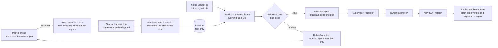

# bee6: the SOP Improvement Agent

A phone listens to a small food-and-beverage shop's day and turns speech into short work notes. A supervisor and an
owner decide, with evidence, how the shop's SOP (standard operating procedure) should change.

Built for the GATI x Google Cloud AI Builder Cup 2026.

- Live demo: [https://web-33uzb53tza-et.a.run.app](https://web-33uzb53tza-et.a.run.app)
- Repository: [https://github.com/ranggabagas30/bee6](https://github.com/ranggabagas30/bee6)

## What it does

One paired phone listens to the shop's working day. The audio is turned into text in memory and dropped: it is never
stored in the cloud. The text is redacted, grouped into short work notes, and checked by an **evidence gate that is
plain code, not AI**. A moment becomes a fact only if the gate's rules pass; otherwise staff are asked about it. When
the day ends, staff answer a short tap debrief ("did this happen, and why?") on the same phone. When the same problem
shows up on several days, an agent drafts one SOP change. A supervisor checks it, the owner approves it, it ships as a
new SOP version, and on a set review date the system compares the shop's notes from before and after and suggests
whether it worked. People decide; the suggestion is a rule in code.

The pilot shop is Proofed, a small food-and-beverage shop in Indonesia. This submission does not report pilot results.
Judges use a fictional demo shop in the same app.

## For judges

| What | Where |
| --- | --- |
| Try the product (about 20 minutes, plus about 10 optional) | [Live demo](https://web-33uzb53tza-et.a.run.app) and "How to test" below |
| Source code | This repository (MIT, see [`LICENSE`](LICENSE)) |
| How it is built | "Architecture and stack" below, [`docs/architecture.md`](docs/architecture.md), [`docs/specs/technical-specification.md`](docs/specs/technical-specification.md) |
| What does not work yet | "Limitations" and "Known gaps" below |

## How to test (about 20 minutes, plus about 10 optional)

Every visit gets its own **private sandbox**: a copy of a fictional bakery that no other visitor can see and that
expires about 2 hours after you start. English is the default; switch to Bahasa Indonesia with the EN / ID toggle (the
Bahasa copy is provisional). Use a phone or a laptop with a microphone and allow the microphone when asked.

The **judge guide** drawer opens by itself on the entry page on a wide screen (on a narrow one, tap its handle row).
It shows one card for the screen you are on and fills in the demo staff code and the sign-in details for you (they are
deliberately not printed here). Follow it. The steps, in order:

**Days 1 to 3 (about 20 minutes)**

1. **Staff, day 1.** On the entry page choose **Staff**, enter the demo staff code (the guide's "Fill in" does it) to
   pair the device, then **Open the listening page** and tap **Start**. The guide shows 5 script cards one at a time;
   read each aloud word for word, then tap **I have spoken this**. No more than 4 people should read cards at the same
   moment.
2. **Close the day.** After the 5 cards, tap **Jump to closing time** in the guide, then **End today**. A 60-minute
   debrief starts. Wait for "Preparing your questions", then answer each question (Yes / No / Skip, with a few words
   of reason where asked).
3. **Supervisor, look around.** Sign out, choose **Supervisor**, and sign in with the details the guide fills in. Open
   the day record, SOP and Connected devices.
4. **Staff, days 2 and 3.** Sign out, choose **Staff** again, and tap **Jump to tomorrow** to start day 2 (and again
   after day 2 for day 3). Run each day as in steps 1 and 2. Do not ask for proposals before day 3 is done: asking locks **Jump to tomorrow**.
5. **Supervisor, decide.** Sign in as Supervisor, open **Proposals**, and tap **Ask Bee6 for proposals**. Open each
   proposal, read the evidence and the "CHECKED BY BEE6" line, change a label if you disagree, then mark it
   **Feasible** (or reject it with a reason).
6. **Owner, approve.** Sign out, choose **Owner**, open Approvals and **Approve** each proposal. Open **SOP** to see
   the new versions with the changed step marked.

**Days 4 and 5, and the review (optional, about 10 more minutes)**

7. **Staff, days 4 and 5.** Days 4 and 5 unlock after the Owner approves a change: **Jump to tomorrow** from day 3.
   Run both as Staff with the new SOP (day 4 has a "phone order, read back" card).
8. **Review.** Sign in as Supervisor and open **Reviews**. Tap **Fast-forward to the review date (simulated)**: there
   is no real wait, and the screen is marked "Simulated time (demo)". Read the before and after counts, the suggestion
   (Worked, Revise or Revert) and the **Bee6 explains** panel, then give the Supervisor verdict. Sign in as Owner and
   confirm it. To run the loop again, reset the demo from the Owner home.

## What to expect

- **Debrief wait.** Usually about 1 to 2.5 minutes after **End today** (QA measured 61 to 160 s; the pipeline runs
  every minute) while the screen says "Preparing your questions". The in-app guide allows 2 to 4 minutes, so keep the
  page open. You get 0 to
  5 questions.
- **Ask Bee6.** About 20 to 40 seconds for proposals. Each shows how many of Bee6's checks it passed.
- **Fast-forward.** About 2 to 15 seconds.
- **Agent wording can be missing.** If an agent's note fails its checker or takes too long, you get the plain card with
  a short notice instead. The suggestion and counts are unaffected.
- **Scripted problem cards keep a plain debrief wording.** Free speech may get an agent-worded question.
- **All three agent flags are ON in the live judging deployment.** The Debrief and Review agents still act only in demo
  sandboxes.

## How it works



1. **Capture.** The phone detects speech in the browser and cuts it into Opus segments of at most 15 seconds. Staff
   tap Start (Mulai) and End (Selesai); capture also stops by itself one hour after closing, and a 1-hour debrief
   starts then.
2. **Transcribe, redact, store.** Each segment is transcribed by Gemini in memory. Sensitive Data Protection redacts
   the text, including person names, before anything is written.
3. **Windows and threads.** Plain code groups lines into windows. A Gemini Flash-Lite call groups lines into threads
   and labels each with one of 12 categories; plain code assembles and stores the threads.
4. **Evidence gate (plain code).** Decides what becomes a fact. Everything else becomes a debrief question.
5. **Proposal.** With at least 2 facts on at least 2 different days within 14 days, the Proposal agent drafts one SOP
   step change from a fixed library of interventions. A plain-code checker (`pgate-v1`) refuses anything that fails.
6. **Supervisor, owner, version.** The supervisor marks it feasible, the owner approves, and a new immutable SOP
   version starts the next day. A rejection reason becomes a constraint later proposals must acknowledge.
7. **Review.** A daily job compares the affected category's rate per captured day before and after. The suggested
   verdict is plain code (a change of 20% or more, with at least 2 captured days on each side). The supervisor, then
   the owner, decide; the owner's verdict is the outcome.

## Architecture and stack

| Part | Choice |
| --- | --- |
| App | Next.js (App Router) and TypeScript strict, one Cloud Run service `web` in `asia-southeast2` (Jakarta): screens, API, pipeline, agents |
| Data | Firestore (Native), `asia-southeast2`; browsers never talk to it |
| Auth | Firebase Auth. Owner and supervisor: email and password, accounts created by an admin script, no self sign-up. Staff: a custom token per phone paired with a 6-digit code |
| Models | Gemini on Vertex AI through `@google/genai`: `gemini-3.5-transcribe-preview`, `gemini-3.5-flash-lite`, `gemini-3.5-flash` |
| Agents | Google ADK for TypeScript: three agents, each with a plain-code checker (below) |
| Async | Cloud Scheduler calls two OIDC-verified internal routes: the pipeline tick and the daily review run |
| Privacy and safety | Sensitive Data Protection redaction; Secret Manager for secrets; zod validation on every API input and model output |
| Browser | `getUserMedia`, AudioWorklet, Silero VAD (ONNX Runtime Web), WebM/Opus muxing, Screen Wake Lock |

**The three agents.** None of them decides a fact or a verdict.

| Agent | Does | Plain-code check | Flag |
| --- | --- | --- | --- |
| Proposal (v4) | Reads SOP sections and evidence through read-only tools and drafts one SOP step change | `check_proposal` tool and the `pgate-v1` gate | `PROPOSAL_AGENT_V4` |
| Debrief | Words the question for a moment the gate already flagged; wording only | Output validation; falls back to the template wording | `DEBRIEF_AGENT` (sandbox only) |
| Review | Explains in plain English the before and after counts and the verdict that code computed | `check_review` against the rule's verdict; falls back to the plain card | `REVIEW_AGENT` (sandbox only) |

**Models and regions.** Each model's location comes from [`config/regions.yaml`](config/regions.yaml) (written by
`npm run probe`), never hard-coded. Transcription and the Flash-Lite label call use the `global` endpoint, the Flash
model uses `asia-southeast1` (Singapore), and Sensitive Data Protection runs in `asia-southeast2`. Services and stored
data are in Jakarta; model processing may happen outside it. The probe ran against the demo project only. By agent:
Proposal runs on `gemini-3.5-flash` (`asia-southeast1`); Debrief and Review run on `gemini-3.5-flash-lite` (`global`).
The table is generated: after a
re-probe run `npm run readme:regions` and paste the output between the markers (a test fails if they differ).

<!-- regions:start -->
| Model | Used for | Location |
| --- | --- | --- |
| `gemini-3.5-transcribe-preview` | Transcription | `global` |
| `gemini-3.5-flash-lite` | Labels | `global` |
| `gemini-3.5-flash` | Proposals | `asia-southeast1` |
| `gemini-live-debrief` | Voice debrief (not built) | Not probed |
| Sensitive Data Protection (service) | Redaction | `asia-southeast2` |

Probed on 2026-10-01 (`config/regions.yaml`).
<!-- regions:end -->

Deploys: a Cloud Build trigger on `main` builds the image ([`cloudbuild.yaml`](cloudbuild.yaml)) and deploys `web`.

## Running locally

You need Node.js and a paid Google Cloud project; real shop data never goes through a free AI Studio key. Sign in with
Application Default Credentials (`gcloud auth application-default login`).

```bash
npm install                  # also points git at .githooks (pre-push runs lint, build and unit tests)
cp .env.example .env.local   # fill in values; the names are listed below
npm run dev                  # local dev server
npm run lint                 # eslint
npm run typecheck            # tsc --noEmit
npm test                     # unit tests (vitest run)
npm run build                # next build
npm run probe                # region probe: writes config/regions.yaml
npm run readme:regions       # prints a models-and-regions table from config/regions.yaml
GOOGLE_CLOUD_PROJECT=<demo project> DEMO_MODE=true npm run seed -- --project demo   # fictional outlet, users, pairing code
npm run provision:web-user -- --project demo --email <email>                        # owner or supervisor account
npm run demo:seed-template   # builds the demo sandbox template through the real segment route (demo project only)
```

The pre-push hook blocks a push if lint, build or unit tests fail; bypass it only deliberately with `--no-verify`.
There is no end-to-end `npm run smoke` yet.

Evaluation scripts call the demo project or read local files. Their inputs stay outside the repository, and none
prints shop data.

```bash
npm run eval                 # label quality against a gold CSV
npm run eval:export          # export redacted lines to CSV for labelling (read-only)
npm run eval:label           # fictional trap line through the real label call
npm run eval:redaction       # redaction recall and precision on fictional fixtures
npm run eval:transcribe      # word error rate and latency on local fictional clips
npm run eval:scenario        # the 5-day judge script through the label path and the gate
npm run eval:proposal        # Proposal agent against the plain-code gate
npm run eval:review-agent    # Review agent: schema, verdict agreement, latency, injection corpus
npm run probe:label-schema   # confirms Vertex accepts the label response schema
```

**Environment variable names** (values live in Secret Manager or an untracked `.env.local`, never in the repository):

| Name | Meaning |
| --- | --- |
| `GOOGLE_CLOUD_PROJECT`, `APP_REGION` | Google Cloud project and the service region |
| `FIREBASE_API_KEY`, `FIREBASE_AUTH_DOMAIN`, `FIREBASE_PROJECT_ID`, `FIREBASE_APP_ID` | Firebase web config for sign-in |
| `TASKS_INVOKER_SA`, `PIPELINE_TICK_AUDIENCE`, `REVIEW_RUN_AUDIENCE` | Expected caller and OIDC audiences of the two internal routes |
| `THREAD_HANDLE_KEY` | Key for thread action handles |
| `FIRESTORE_DATABASE_ID` | Optional named Firestore database (staging); unset uses the default |
| `PROPOSAL_AGENT_V4` | Exactly `true` turns on the tool-using Proposal agent |
| `DEBRIEF_AGENT` | Exactly `true` turns on the Debrief wording agent (sandbox outlets only) |
| `REVIEW_AGENT` | Exactly `true` turns on the Review explanation agent (sandbox outlets only) |
| `DEMO_MODE` | Demo project only; must stay unset for a real shop |
| `DEMO_IP_SALT`, `DEMO_XFF_FROM_END` | Salt for the per-network hash and the proxy-header setting behind demo rate limits |
| `DEMO_SANDBOX_IP_CAP`, `DEMO_SANDBOX_DAILY_CAP`, `DEMO_SWITCH_IP_CAP` | Demo sandbox and role-switch caps |
| `DEMO_SEGMENT_*`, `DEMO_GENERATE_*`, `DEMO_FAST_FORWARD_*`, `DEMO_NEXT_DAY_*`, `DEMO_REDACT_*`, `DEMO_MODEL_DAILY_CAP` | Per-sandbox and per-day limits on recordings, proposals, time skips and redactions |
| `NEXT_PUBLIC_DEV_CONTROLS` | Developer panel on `/capture`; keep it off in every real build |
| `CLOUD_TASKS_QUEUE`, `DAILY_TOKEN_CEILING`, `NEXT_PUBLIC_DEVICE_AUDIO_QUEUE` | Named in the project rules, not read by any code yet |

## Privacy and hard rules

- **Google only.** Gemini on Google Cloud through `@google/genai` and Google ADK, with the project's service account.
  No other AI provider, SDK or key in product code.
- **Audio is never stored in the cloud.** It arrives in the segment request, is transcribed in memory and dropped. No
  Cloud Storage writes; no audio or base64 in logs, errors or Firestore.
- **Redaction before storage.** Sensitive Data Protection runs on transcript lines, and on debrief reasons after a
  staff-name scrub, before anything is written.
- **People data.** Staff names live only in the `staff` collection. Threads, questions, answers, proposals, outcomes
  and audit logs store no name and no staff id. An answer stores only the answering device and timestamps, so
  supervisors see "a staff member answered", never who.
- **Browsers never talk to Firestore.** Every read and write goes through our API, which checks role and shop on the
  server.
- **SOP changes only through proposals** (evidence, supervisor, owner). No endpoint edits the SOP directly.
- **Retention.** Redacted segment text expires after 48 hours; debrief answers after 14 days.
- **The repository holds no real SOP, transcripts, staff or customer data, keys or audio.** Demo data is fictional.

## Limitations

- **Transcription is a preview model and Vertex capacity is shared.** Many phones starting in the same second can get
  429 or "Server busy". The phone keeps retrying for up to about 4 minutes after End.
- **The Review agent does not always produce an accepted note.** In our eval (demo project, real Gemini Flash-Lite,
  18 Oct) the agent's verdict matched the plain-code verdict on every run in 5 of the 8 core cases; across the 40 core
  runs, 5 fell back to the plain card (12.5%). There were zero rule violations in 50 accepted notes against 10
  prompt-injection cases. The suggestion is always the rule's.
- **Demo caps exist** per network, per sandbox and per day, so a very busy day can refuse a new sandbox.
- **Capture needs the page open, the screen on and the phone plugged in.** There is no native app. A forgotten Start
  looks like a day off.
- **Consent is collected outside the app** (paper contract plus an emailed notice, privacy policy and terms).
  Revocation is manual, handled within 7 working days.
- **A full DPIA under Indonesia's PP 33/2026 is the next priority after submission.**
- **Bahasa copy is provisional**; English is final.
- **The on-device encrypted audio queue (capture phase P3) is not built.** Without it, about 10 minutes of speech
  survive a network drop, and only while the page stays open.
- **14-day thread-text deletion (capture phase P4) is not built.** Thread text has no expiry yet. Staff names are
  scrubbed before it is stored.
- **Firestore TTL deletion lags**; it is used today for segment text and debrief answers.
- **Staff are never named to supervisors**, so a supervisor cannot see who answered.
- **Minor UI gaps:** a stale "retrying" row can stay visible after a Jump, and review dates shift by design after the
  demo's day jumps.

## Known gaps

- Some models run outside Jakarta (see Architecture and stack). Re-probe `config/regions.yaml` on the pilot project
  before the pilot handles real data.
- There is no pilot outcome to report. The closed loop is shown on the demo shop: its earlier days are fictional clips
  sent through the real pipeline with back-dated times, the review fast-forward is simulated, and a visitor's own
  session and debrief are real.
- The daily per-shop token ceiling (`DAILY_TOKEN_CEILING`) is specified but not enforced. The demo uses request-count
  caps instead.
- Constraints created by rejection reasons cannot be edited or deleted in the app.
- An SOP step longer than 400 characters cannot be changed by a proposal; approval is refused rather than truncated.
- A shop's SOP is loaded by a seed script; there is no upload screen yet.
- The category definitions, proposal rubric and intervention library are v0 drafts, not yet reviewed by the domain
  expert.
- The incident-keyword fast path (a safety keyword flags a moment at once) is specified, not built.
- Sensitive Data Protection misses some Indonesian street-address forms ("Komplek ... Blok ... No.") and only partly
  redacts "Jalan ... No." addresses. Phone numbers, emails and names were redacted correctly in the same check.
- The debrief answer route has no per-device rate limit yet.
- Staff first names also sit in a private, gitignored vocabulary file used for transcription; whether this fits the
  rule that names live only in `staff` is waiting on the domain expert.
- Demo only: the sandbox's resume state lives in that browser's storage, so another browser starts over. On Safari a
  tap within about a second of the sign-in page loading may not move focus into the panel.
- Cosmetic: a CSS preload hint can show in the console after sign-out.

## Licences and credits

bee6 is MIT-licensed: see [`LICENSE`](LICENSE). Third-party components are listed in
[`THIRD_PARTY_NOTICES.md`](THIRD_PARTY_NOTICES.md). Project rules are in [`CLAUDE.md`](CLAUDE.md).

---

Built with Claude Code. Runs entirely on Google Cloud and Gemini.
