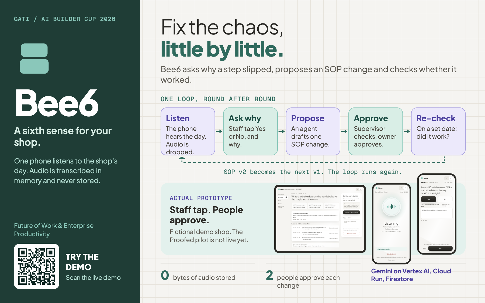

# bee6: the SOP Improvement Agent

A phone listens to a small shop's day and helps the team improve how the shop runs.

- Live demo: [https://web-33uzb53tza-et.a.run.app](https://web-33uzb53tza-et.a.run.app)
- Code: [https://github.com/ranggabagas30/bee6](https://github.com/ranggabagas30/bee6)
- Brand guidelines: [Bee6 Brand Guidelines](https://claude.ai/artifact/XX2Q2kDXHLacsXwgFdm43t)

Built for the GATI x Google Cloud AI Builder Cup 2026.

## What it is

A phone in a small shop listens while staff work. Bee6 turns what they say into short written notes. It never keeps the
audio. When the same problem keeps coming up, Bee6 suggests a better step in the shop's SOP, the written guide for how
to do things. A supervisor checks the idea and the owner approves it. Later, Bee6 looks at the notes again and checks
whether the change worked. People always make the decisions.

It is built for a real shop, Proofed in Indonesia. The demo uses a made-up bakery and made-up data.

## Try it in about 20 minutes

Each visitor gets a private copy of the demo bakery. It lasts about 2 hours. A guide panel opens by itself and shows
the next step, the demo code and the demo sign-in details. English is the default; switch to Bahasa Indonesia with the
EN / ID button. Use a phone or laptop with a microphone.

1. Open the live link and choose **Staff**. Enter the demo code the guide shows. You are now a shop worker.
2. Tap **Start**. The guide shows 5 cards. Read each card aloud, then tap **I have spoken this**.
3. Tap **Jump to closing time**, then **End today**. Wait for the questions, then answer them (Yes, No or Skip).
4. Back as Staff, tap **Jump to tomorrow** and play day 2 and day 3 the same way. (You may sign out and look around as
   **Supervisor** first.) Do not ask for suggestions before day 3 is done.
5. As Supervisor, open **Proposals** and tap **Ask Bee6 for proposals**. Read the evidence and mark one **Feasible**.
6. Sign out and choose **Owner**. Open Approvals and tap **Approve**. Open **SOP** to see the new version.
7. Optional, about 10 more minutes: as Staff, play day 4 and day 5 with the new SOP.
8. As Supervisor, open **Reviews** and tap **Fast-forward to the review date (simulated)**. Read whether the change
   worked, then give your verdict. Confirm it as Owner.

## What to expect

- The questions appear 1 to 3 minutes after you end the day. Keep the page open.
- Suggestions take under a minute.
- The fast-forward is simulated, so there is no real waiting.
- If many people start at the same moment, things can take a little longer.
- If Bee6's written explanation does not appear, a plain card shows instead. The result itself does not change.

## Want the details?

- [How it is built](docs/architecture.md)
- [Technical specification](docs/specs/technical-specification.md) (rules, privacy, retention and open items)
- [Project rules](CLAUDE.md)
- [Deploy setup](cloudbuild.yaml)
- [Model locations](config/regions.yaml)

For engineers: stack and model regions

- Next.js and TypeScript on one Cloud Run service in `asia-southeast2` (Jakarta); Firestore for data.
- Firebase Auth: email and password for owner and supervisor; a 6-digit code pairs a staff phone.
- Gemini on Vertex AI through `@google/genai`; three agents on Google ADK for TypeScript, each with a plain-code checker.
- The rule that turns a note into a fact, and the review verdict, are plain code, not AI.
- Sensitive Data Protection redacts text before it is stored. Cloud Scheduler runs the pipeline.
- Commands and environment variable names: see `package.json` and `.env.example`.

<!-- regions:start -->
| Model | Used for | Location |
| --- | --- | --- |
| `gemini-3.5-transcribe-preview` | Transcription | `global` |
| `gemini-3.5-flash-lite` | Labels | `global` |
| `gemini-3.5-flash` | Proposals | `asia-southeast1` |
| `gemini-live-debrief` | Voice debrief (not built) | Not probed |
| Sensitive Data Protection (service) | Redaction | `asia-southeast2` |

Probed on 2026-10-01 (`config/regions.yaml`).
<!-- regions:end -->

By agent: Proposal runs on `gemini-3.5-flash` (`asia-southeast1`); Debrief and Review run on `gemini-3.5-flash-lite` (`global`).

Built with Claude Code. Runs entirely on Google Cloud and Gemini.
