# Technical Specification Document: bee6, the SOP Improvement Agent

**Sources of truth:** `docs/plan.md` for sprints; `docs/specs/technical-specification.md` (§8) for
capture and session rules; `docs/specs/web-backend-rbac.md` (§6.6) for routes and data;
`docs/tasks/UX-03-journey-design.md` for screens and copy.
Precedence: `CLAUDE.md` → this document → `docs/plan.md` → `docs/backlog.md` (the order in `CLAUDE.md` §1).
Reconciled 4 Oct 2026 (tech-lead): debrief timing wording, answer storage, the off-day cut-off, scheduled
work, latency and debrief timing in §5.1, and diagrams §7.3, §7.5, §7.6, §7.7 and §7.10.

> **Updated 18 Oct 2026 (tech-lead, docs only): as built at the release on `main`.** This document now
> describes the system that runs on the demo service `web`. New: **§9 As built** (the three agents and their
> plain-code checkers, the per-visitor demo sandboxes and their 5-day journey, capture and transcription
> resilience, late-line continuation, flags and environment, scheduled jobs, the model and region table) and
> **§10 Known gaps and limitations** (the honest list; it replaces the short §6.5). Corrected in place: sign-in
> is email + password for owner and supervisor (admin-provisioned, no self sign-up; the Google sign-in plan was
> replaced on 9 Oct); there is **no Critic agent** (dropped 16 Oct; the plain-code `check_proposal` tool plays
> that role, §3.1 step 6, §3.3, §4.1, §5.2 and the diagrams); the pipeline runs on a Cloud Scheduler tick and
> uses no Cloud Tasks (§3.3, §6.4); the phone's upload retry is a 4-minute budget per segment, not 6 tries
> (§7.3, §8.8). The pilot shop has not gone live (go-live postponed by Rangga on 9 Oct, no new date); nothing
> here reports real-shop results. Hard rules (`CLAUDE.md` §2) and the privacy rules of §8 are unchanged and
> were re-checked against the code (§9.8).

> **Updated 4 Oct 2026, MVP 1 answer shape (tech-lead, docs only; Rangga, 4 Oct, final; `docs/HANDOFF.md`
> "Debrief answer shape for MVP 1"). Supersedes the free-text-only answer in the note below.** Each debrief
> question gets exactly one answer: **Yes or No plus a required reason, or Skip**. Yes confirms the thread's
> label (the gate's `staff_confirmed` input); No rejects it (the gate's `staff_rejected` branch: the thread is
> never used as evidence and the question is closed as rejected). The reason is required, at most 500
> characters (refused, never cut), name-scrubbed and redacted, and only stored and shown; nothing reads it
> to decide a label, a verdict or a gate input. Free text that changes the label is post-MVP 1. A refused
> answer is not an answer: the question stays open and expires as unverified. Changed: §2 step 5, §4.3
> Question entity, §4.4 supervisor row, §7.1 and §7.2 (one line each), §7.8 caption and diagram.

> **Updated 4 Oct 2026, final (tech-lead, docs only): debrief answer shape (Rangga, 4 Oct, final;
> `docs/HANDOFF.md` "Debrief answer shape").** A debrief answer is **one free-text explanation of why** an
> SOP step was or was not done properly, typed by whoever holds the device; it is not a yes/no and not a
> choice list. An empty explanation is not an answer; longer than 500 characters is refused, never cut;
> staff names are scrubbed and personal details redacted before it is stored. A confirming answer still
> feeds the evidence gate the same way as before (it confirms the thread's label; the gate never reads the
> text). Supervisors do not answer device questions; they confirm or override labels. A fully answered
> debrief does not end early or release Mulai sooner. Changed: §2 step 5, §4.3 Question entity, §4.4
> supervisor row, §7.1 and §7.2 (one line each), §7.8 caption and diagram.

> **Updated 4 Oct 2026, late (tech-lead, docs only): the Mulai gate, multi-device, role-agnostic
> questions (Rangga, 4 Oct, final; `docs/HANDOFF.md`).** A device's Mulai is not offered until that
> device's previous-business-day debrief has timed out, unless that day was an off-day for it; no undo for
> Selesai or cancel (accepted MVP 1 limit). Several devices may run sessions at once, each with its own
> session, debrief, expiry and Mulai gate; the insight run merges all devices and counts one episode heard
> by two devices once. Debrief questions are role-agnostic (was the SOP step done properly, and if not,
> why); answers store the device id and timestamps only, no role. Changed: §2 step 5, §4.3 Question
> entity, §7.1 (one line), §7.2 and §7.8 diagrams. Rule detail: §8.3 rule 6,
> §8.10–§8.11, §8.15.

> **Updated 4 Oct 2026 (tech-lead, docs only): sign-in and consent (Rangga, 4 Oct, final; `docs/HANDOFF.md`). Updated 9 Oct: auth method (Rangga, 9 Oct).**
> Owner and supervisor use email + password (accounts created by an admin provisioning script; no self sign-up); staff need no sign-in. **Consent is not collected in the app:**
> it is covered by the paper contract between bee6 and Proofed, and bee6 emails the consent, the updated
> privacy policy and the TnC to all users. The in-app consent gate (the outlet's consent flag, the "no
> consent" view, the staff-consent step) is **removed from MVP 1**. Revocation stays manual (within 7
> working days), with **no in-app revoked-consent state**: capture is stopped on the phone or by revoking
> the device token, and resumes only by re-pairing. The privacy line on the phone stays as an in-app
> **notice**, not consent collection. Changed: §2.4, §4.1 capture row, §4.3 Outlet row, §6.5, §7.2 and
> §7.10 diagrams.

> **Updated 4 Oct 2026 (tech-lead, docs only): MVP 1 device model (Rangga, 4 Oct, final).** MVP 1 has no
> staff sign-in: staff only pair a device, and the system tracks the device id only (a shop phone and a
> staff phone are the same to it). Every session rule runs per device, the same way in any mode. The mode
> is derived and is a label only (one active paired device = "room mode", more than one = "wearable
> mode"). Debrief answers are sent by the device and stored as "a staff member" plus the device id, never
> a name. Staff name + PIN sign-in is kept as a **post-MVP 1** concept. Changed: §2 step 5, §3 sign-in row,
> §4.3 Staff and Device entities, §4.4 interfaces, §5 threat row, §7.1 and §7.8 diagrams. Full rule:
> `docs/specs/web-backend-rbac.md` §2a.

> **Updated 3 Oct 2026 (aligned with `docs/plan.md` v5):** capture is no longer unattended; it starts on a staff tap of Mulai and stops on Selesai or the hard auto-stop 60 min after closing; the debrief opens after Selesai; pilot go-live is one step, after internal testing on a test outlet and Rangga's written sign-off; the pilot review falls after submission, so the closed loop is shown on the demo outlet before then.

> **Updated 4 Oct 2026:** added §7 Diagrams (one end-to-end sequence diagram and ten per-feature flowcharts) for the flows as decided in `docs/plan.md` §5d and the session rules (now §8): Mulai eligibility (01:00 rule), offline-first upload and status lines, gap ledger, cancel session, auto-stop, business-day attribution, debrief, insight runs, consent revocation, and the pilot go-live gate. Diagrams only; no rule changed.

> **What this document is.** The technical idea behind bee6: the concepts, components, data meaning and
> contracts, explained at the level of *what* and *why*. It is meant to stay true however the code is
> written today. It does not name files, functions or library internals. That detail lives in
> `docs/tasks/R-xx.md` and in the code itself.
>
> **Doc precedence.** If this document disagrees with another one, the order in `CLAUDE.md` §1 wins:
> `CLAUDE.md` → this document → `docs/plan.md` → `docs/backlog.md` → `docs/specs/web-backend-rbac.md` →
> `docs/architecture.md` → `docs/specs/pipeline-and-agents.md` → `docs/specs/product-spec.md` → `docs/adr/`.
> §1 to §7 summarise and explain; §8 is normative; §9 records what is built and §10 what is not.

---

## 1. Document Metadata & Overview

| Field | Value |
|---|---|
| **TSD ID** | TSD-BEE6-001 |
| **Title** | bee6: SOP Improvement Agent, technical specification |
| **Author / Owner** | Rangga Bagas (the sole engineer) |
| **Reviewers** | GATI (product), Tiffany (prompts, categories, pilot coordination); the tech-lead agent for technical review |
| **Linked tickets** | Plan and calendar: `docs/plan.md`. Tasks R-01 to R-16 with "done when" checks: `docs/backlog.md`. Acceptance criteria (T-xxx): `docs/specs/pipeline-and-agents.md` and `docs/specs/web-backend-rbac.md` |
| **Status / Release** | As built on 18 Oct 2026 (release on `main`, served by the demo service `web`). Hackathon submission (GATI × Google Cloud AI Builder Cup 2026). The pilot is not live |

**In one sentence.** One phone listens to a small food-and-drink shop's day, turns speech into short
redacted work notes (the audio is never kept), asks staff *why* gaps happened in a short debrief after Selesai,
and proposes changes to the shop's standard operating procedure (SOP). A supervisor and the owner approve
each change, it ships as a new SOP version, and on a set date the system checks whether it worked.

---

## 2. Context & Problem Description

### 2.1 Problem
Small F&B outlets repeat the same operational mistakes: stockouts, missed steps, uneven complaint
handling. Nobody records *why* these things happen, so the SOP never changes based on evidence. Existing
tools check whether today's SOP was followed. None of them changes the SOP and then checks whether the
change helped. (Full problem statement: `docs/specs/pipeline-and-agents.md` §A1.)

### 2.2 Current vs expected behaviour

| | Today (without bee6) | With bee6 |
|---|---|---|
| What happened in the day | Remembered loosely, talked about in weekly meetings | A timeline of labelled work "threads", each with redacted evidence lines |
| Why it happened | Rarely asked, never recorded | Asked in a short debrief after Selesai or the auto-stop, with answers stored with the device id only, no name and no role |
| SOP changes | Ad hoc, based on opinion | Proposed only from dated evidence, checked by a supervisor, approved by the owner |
| Did the change work? | Unknown | Checked on a set review date. The verdict is confirmed by humans and remembered |

### 2.3 Goals
Goals are set in `docs/specs/pipeline-and-agents.md` §A2. In short:
1. Run one real loop at the pilot shop on real dates: evidence → proposal → supervisor → owner → new SOP
   version with a set review date. The pilot review falls after submission; before then the review and
   recorded outcome are shown on the demo outlet (fast-forward, labelled simulated).
2. Capture covers ≥ 90% of planned opening hours on days with a session (session time minus capture
   gaps); staff press Mulai and Selesai only. The only automatic stop is the hard auto-stop 60 minutes
   after closing. A day with no Mulai by the end of its Mulai window (close − 4 h) is recorded as off / closed, with no gap alarm.
3. Label quality is measured on a human-labelled gold set.
4. A judge can operate the full loop on a fictional demo outlet in a few minutes.
5. Cost per outlet per day is measured, not guessed.

### 2.4 Non-goals (out of scope for this window)
- **A full data protection impact assessment (DPIA)** under Indonesia's PP 33/2026. It is the next priority
  after submission. Consent and signage are *not* deferred. *(4 Oct: consent is covered by the bee6–Proofed
  paper contract plus an emailed consent, privacy policy and TnC to all users; it is not collected in
  the app.)*
- **Tuning transcription for languages or dialects beyond what the pilot shop speaks.**
- **Real-time SOP editing.** No one edits the SOP directly. Every change goes through a proposal
  (`CLAUDE.md` §2 #9).
- **Streaming transcription or live captions.** Not a product need, and far more expensive. The only
  real-time part would be the voice debrief, which is not built (R-16, "if time").
- **A cheaper "first-pass" transcription path.** It is modelled for the deck but not built.
- **A separate demo architecture**, a native Android app, and the photo, reminder, second-mic and
  event-card features.
- **Automatic approval.** No category becomes trusted automatically, and no change ships without both
  human approvals.

Lists of "cut" and "if time" items: `docs/plan.md` §2 and §8.

### 2.5 Reproduction steps
N/A. This is a new product, not a bug fix.

---

## 3. Proposed Solution

### 3.1 High-level design: the concept chain

bee6 is a chain of steps. Each step turns uncertain input into something a little more trustworthy, and
humans hold the final say.

1. **Listen (capture).** The shop phone's browser detects speech on the device and cuts it into short
   segments of 15 seconds or less. Silence is never uploaded. Segments wait in memory on the phone until
   they upload. They are never saved to the phone's storage.
2. **Short work notes (transcribe + redact).** Each segment is transcribed while the upload request is
   still open. Personal details (phone numbers, emails, customer names, addresses) are redacted, and only
   then is the text stored. The audio is dropped when the request ends. Stored segment text expires after
   48 hours.
3. **Understand (windows, threads, labels).** On a fixed schedule, the stored lines are grouped into
   *windows* (stretches of talk separated by long silences). A labelling model links the lines into
   conversations (*threads*), gives each thread one category from a fixed list, scores its confidence,
   points to its evidence lines, and names a runner-up category with the reason it lost. Small talk that
   isn't about work is removed and only counted.
4. **Evidence gate (plain code).** Fixed, readable rules decide whether a labelled thread becomes a
   **fact** or a **question**. A label becomes a fact only if its confidence is high enough, it has
   evidence, and its category doesn't always need a supervisor (complaints, corrections, safety, security
   and disruption always do). Everything else becomes a question. The gate is not AI (`CLAUDE.md` §2 #10).
5. **Debrief questions.** After staff tap Selesai (or the hard auto-stop fires), whoever holds a paired
   device answers up to five short questions about the episodes that device heard, with no sign-in (MVP 1;
   a staff name + PIN sign-in is a post-MVP 1 concept). Questions are about the step, never about the person,
   and never depend on who answers: each asks whether the SOP step was done properly and, if not, why.
   The answer (4 Oct, MVP 1) is Yes or No (did the labelled step happen) plus a required reason in the
   person's own words, at most 500 characters, or Skip; an empty reason is not an answer; staff names are
   scrubbed and personal details redacted before it is stored. Yes lets the plain-code gate confirm that
   thread's label; No rejects it, so the thread is never used as evidence. Nothing reads the reason to decide
   a label, a verdict or a gate input; free text that changes the label is post-MVP 1. Only the device answers; supervisors confirm or
   override labels instead. Finishing every question does not end the debrief early.
   Answers keep only the answering device id and the time, never a name or a role; supervisors see "a
   staff member answered". With several devices, each runs its own debrief on its own clock, and the
   insight run merges every device's answers. A staff answer about a complaint or incident only
   counts once a supervisor confirms it. Unanswered questions expire as "unverified" and never become facts.
6. **Proposal.** An agent reads the facts, confirmed answers, the current SOP and every past rejection
   reason. It proposes one change picked from a fixed library of interventions. Each proposal must cite at
   least one rubric criterion and at least two dated pieces of evidence, and must state a metric, a failure
   condition and a review date. If the evidence is too thin, it makes no proposal and logs why. Before any
   human sees a proposal, plain code checks it: the proposal gate (`pgate-v1`) and, with the tool-using agent
   (§9.1), its `check_proposal` tool. *(A separate Critic agent was planned and dropped on 16 Oct: the
   plain-code check is the critic, so no model judges another model.)*
7. **Supervisor.** Marks a proposal *feasible* or *rejects it with a reason*. Every rejection reason
   becomes a permanent rule for that outlet, and all later proposals must respect it.
8. **Owner.** Approves or rejects, and only after the supervisor has said feasible. Nothing ships without
   both approvals.
9. **New SOP version.** An approved change creates a new, unchangeable SOP version, with a diff against
   the previous one. The pipeline uses the new version from the next morning.
10. **Outcome review.** On the review date, a scheduled job compares the metric before and after the
    change and plain code (rule `rev-v1`) suggests *worked*, *revise* or *revert*. Supervisor and owner
    confirm it. An outcome nobody confirms is stored as "unknown" and is kept out of the system's memory. On
    the demo sandbox fast-forward, a Review agent may add a plain-English explanation of that suggestion; it
    never changes it (§9.1).

The idea that runs through every step: **AI suggests, plain code filters, humans decide.** Anything
uncertain becomes a question for a person, never a silent fact.

### 3.2 Alternatives considered

| Decision | Options | Pros / cons | Chosen, and why |
|---|---|---|---|
| **How the pipeline is triggered** | (a) One background task per uploaded segment. (b) One scheduled "tick" every couple of minutes that processes each device in order, under a lease | (a) Lower latency, but tasks run in parallel and race over which thread is still "open" for a device, which needs extra de-duplication and concurrency machinery. (b) Simple and ordered, with no races. Costs up to about two minutes of label delay and one scheduler job | **(b) Scheduled tick.** Nothing reads a label before the debrief (it starts at Selesai or the auto-stop, at the earliest 4 h after Mulai), so two minutes of delay is invisible. Ordering is a correctness requirement for threads. (`docs/tasks/R-05b.md`, Decision 3) |
| **Shape of model output** | (a) Free-text answers parsed afterwards. (b) Strict structured output: a fixed category list, numeric confidence, evidence as line references, length-capped text fields | (a) Flexible, but can invent categories, re-quote (and leak) text, and drift. (b) Narrower, but checkable by a validator, and unknown categories are rejected | **(b) Strict structured output**, validated on every call. Any free text the model does return is redacted again before storage, and a failure blocks storage (fails closed). A failed validation becomes a question, never a fact |
| **When processing happens** | (a) All understanding inside each upload request. (b) Transcription inside the request; understanding on the schedule | (a) Would need audio or context kept around longer, and couples upload latency to model latency. (b) Audio lives exactly one request; the slower steps run when convenient | **(b).** Transcribing inside the request is what lets the audio never be stored (`CLAUDE.md` §2 #2) |
| **Who decides fact vs question** | (a) The model's own confidence. (b) Plain-code rules applied to the model's output | (a) Not auditable, and the model can be confidently wrong. (b) Testable, explainable, and logged with the rule that fired | **(b) Plain-code evidence gate** (`CLAUDE.md` §2 #10) |
| **Transcription mode** | (a) Live streaming. (b) Short segments sent in batches | (a) Live captions nobody needs, at 2–3 times the price. (b) Cheap, retryable and idempotent | **(b) Segments** (`docs/specs/pipeline-and-agents.md` §A5, D1) |
| **Transcription coverage** | (a) A cheap model first, the strong model only when unsure. (b) The strong model for all speech | (a) Cheaper, but more moving parts and a second error source. (b) Simple, one quality bar | **(b)** for this window. (a) is modelled, not built |
| **Deployable units** | (a) Separate ingest, pipeline and agent services. (b) One web service | (a) Cleaner separation, more operating work. (b) One thing to deploy for a one-person team | **(b) One service**. The architecture diagram still names each agent. (`docs/adr/ADR-001-lean-gemini-architecture.md`) |
| **Capture device** | (a) A native Android app. (b) A browser page on the shop phone | (a) More control over the background. (b) No app store, same codebase, needs the page open and the screen on | **(b) Browser capture**, with the screen-on limit stated as a known gap |
| **Database access** | (a) Browser talks to the database under security rules. (b) All access through the app's API | (a) Less server code, but five roles' worth of rules that are hard to audit. (b) One place checks role and outlet | **(b) API only** (`CLAUDE.md` §2 #6) |

### 3.3 External components and dependencies

All product dependencies are Google Cloud and Google AI (`CLAUDE.md` §2 #1).

| Role in bee6 | Product (stable external contract) |
|---|---|
| A speech-to-text model (verbatim mode, custom vocabulary, Indonesian) | Gemini 3.5 Transcribe (preview) |
| A fast labelling model with structured output | Gemini 3.5 Flash-Lite |
| A reasoning model for the Proposal agent | Gemini 3.5 Flash |
| A small model for the Debrief and Review agents (wording and explanation only) | Gemini 3.5 Flash-Lite (one constant each; switchable to Flash) |
| A real-time voice model for the spoken debrief | Not built (R-16, "if time"). The region probe found no Live API model id it could reach |
| An agent framework | Google Agent Development Kit (ADK) for TypeScript (`@google/adk`, pinned), `LlmAgent` + `InMemoryRunner`, on Vertex AI |
| Model access | Google Cloud's Gemini platform (Vertex mode) through a service account. Never consumer keys |
| Hosting | Cloud Run, Jakarta (`asia-southeast2`) |
| Database | Firestore (Native mode, Jakarta) |
| Sign-in and identity | Firebase Authentication (email + password for owner and supervisor with accounts created by an admin provisioning script; custom tokens for paired devices; staff PIN sessions are post-MVP 1) |
| Scheduled work | Cloud Scheduler: the pipeline tick and the daily review run (§9.7), both OIDC-signed. Capture start/stop and the debrief follow Mulai, Selesai and the auto-stop, not a schedule (§8.3). Cloud Tasks is not used by the built system |
| Redaction | Sensitive Data Protection |
| Secrets | Secret Manager |
| On-device speech detection | An open-source voice-activity detector running in the browser (licence checked) |

Model locations are not fixed in code. Each model's location comes from a region configuration filled by
a probe, preferring Jakarta, then Singapore, then global (`CLAUDE.md` §2 #5). Some models currently answer
only on the global endpoint, which is stated as a known gap.

---

## 4. System Architecture & Data Design

### 4.1 Architecture overview

| Layer | Responsibility |
|---|---|
| **Capture (shop phone browser)** | Microphone, on-device speech detection, cutting speech into segments, compression, an in-memory upload queue with retry, a heartbeat, keeping the screen awake, starting only on Mulai and stopping on Selesai or the hard auto-stop (opening hours drive reminders and the auto-stop time only), showing the privacy line as an in-app notice (not consent collection). *~~Respecting the outlet's consent flag~~: removed 4 Oct, no in-app consent gate in MVP 1* |
| **Ingest (segment interface)** | Checks the device identity, transcribes in memory, redacts, stores the text with timestamps, drops the audio. A repeated upload of the same segment is accepted without being transcribed twice |
| **Understanding pipeline (scheduled)** | Groups lines into windows, calls the labelling model, builds threads that can span windows, applies the evidence gate, writes facts and questions. Runs one device at a time, oldest first, so no two runs fight over the same thread |
| **Agents** | Proposal (tool-using, behind a flag), Debrief (question wording only, demo sandboxes) and Review (explains the plain-code verdict, demo sandbox fast-forward). Each one's output passes a plain-code checker; none writes an SOP change (§9.1). The tap debrief is plain code; the voice debrief is not built |
| **Screens** | Capture status, staff debrief, the supervisor's day record and approvals, the owner's summaries and approvals, the demo "Try as…" landing page |
| **Data** | Firestore. Every record belongs to exactly one outlet |
| **Platform** | Identity, scheduling, secrets, redaction, model access, all on Google Cloud in Jakarta |

All of the server-side layers run inside **one web service**. That is a deployment choice, not a design
boundary: each layer only talks to the others through stored data or its own internal interface.

### 4.2 Main flow

```mermaid
sequenceDiagram
    autonumber
    participant Phone as Shop phone (capture page)
    participant API as bee6 service
    participant STT as Speech-to-text model
    participant SDP as Redaction service
    participant DB as Firestore
    participant Tick as Scheduler (pipeline tick)
    participant LBL as Labelling model
    participant Staff as Staff (debrief)
    participant Sup as Supervisor
    participant Own as Owner

    Phone->>API: speech segment (audio, in the request only)
    API->>STT: transcribe in memory
    STT-->>API: raw text
    API->>SDP: redact
    SDP-->>API: redacted text
    API->>DB: store redacted line (expires in 48 h)
    Note over API: audio dropped when the request ends
    Tick->>API: tick (service identity)
    API->>DB: read new lines for one device
    API->>LBL: indexed redacted lines
    LBL-->>API: threads, category, confidence, evidence refs
    API->>API: evidence gate (plain code) → fact or question
    API->>DB: threads (facts) + questions; non-work lines deleted
    Staff->>API: debrief answers: yes / no + reason, reason scrubbed + redacted (device id, no name)
    API->>API: Proposal agent, checked by plain code (pgate-v1, check_proposal)
    API-->>Sup: proposal with dated evidence
    Sup->>API: feasible, or reject + reason (reason becomes a rule)
    API-->>Own: feasible proposal
    Own->>API: approve
    API->>DB: new immutable SOP version
    Tick->>API: review date reached
    API-->>Sup: worked / revise / revert suggestion
    Sup->>API: confirm verdict (with Owner)
    API->>DB: outcome
```

### 4.3 Data model (concepts and privacy rules)

Every stored record carries its outlet. A request can only reach records of its own outlet.

| Entity | What it means | Privacy rule |
|---|---|---|
| **Outlet** | One shop: its opening hours, time zone, settings (*the consent flag is removed from MVP 1, 4 Oct: consent is by contract; a legacy field may remain in old docs, unread*) | Fictional in the demo; real details never in the public repo |
| **Staff** | The people who work there, with a role (and a hashed PIN, dormant in MVP 1). In MVP 1 their names are used only to scrub names from stored text and as transcription vocabulary; routing questions to a person and signing staff in are post-MVP 1 | **The only place staff names exist** (`CLAUDE.md` §2 #7) |
| **User** | An owner or supervisor who signs in with email + password (accounts created by an admin provisioning script), linked to one outlet and one role | Identity managed by the sign-in service |
| **Device** | Any paired phone (the shop phone or a staff member's own phone; the system does not tell them apart) and its health heartbeats. Each device runs its own sessions and debrief. The number of active paired devices gives a display-only mode label (one = room mode, more = wearable mode) that no rule reads | Holds no speech content and no person's name or label. Its id is never shown next to an answer or thread to supervisors or owners, because in wearable mode a phone is usually one person's |
| **Segment** | One short stretch of speech as redacted text lines, with the device's start and end times and which model and location produced it | Redacted before storage (§2 #3). Expires after 48 hours. Never contains audio. Non-work lines are deleted after labelling and only counted |
| **Window** | A group of segments between long silences: the unit sent for labelling | Derived from segments and holds no extra content |
| **Thread** | One work conversation or episode: category, short summary, structured fields, confidence, runner-up, evidence references, and fact or question status | Keeps its own redacted work-line text beyond 48 hours so later proposals can cite it (§2 #7a). Roles only, never names, never non-work lines |
| **Question** | A debrief question created by the gate or the proposal agent, carrying the device that heard it, with its answer and status (open, answered, confirmed, expired as unverified). The answer is Yes or No plus a required reason (at most 500 characters; an empty reason is not an answer); No closes the question as rejected (4 Oct, MVP 1) | Questions are role-agnostic (an SOP step done properly or not, and why). The reason is name-scrubbed and redacted before storage, and it is never read by the gate: Yes confirms the thread's existing label, No rejects it (the thread is excluded from evidence). Answers store the answering device id and timestamps only, no role and never a name. Only a paired device answers. Supervisors see "a staff member answered Yes / No" and the redacted reason, never who or from which device; owners see summaries only |
| **Correction** | A supervisor's confirmation or override of a label | Role only |
| **Proposal** | One suggested SOP change: the intervention, rubric criterion, dated evidence references, metric, failure condition, review date, and status (suppressed, blocked, awaiting supervisor, awaiting owner, approved, rejected) | Roles and SOP steps only. Suppressed proposals are logged with a reason |
| **Constraint** | A permanent outlet rule taken from a rejection reason | Roles only |
| **SOP version** | One unchangeable version of the outlet's procedure, plus the change that produced it | The real pilot SOP never enters the public repo (§2 #8) |
| **Review / Outcome** | The comparison on the review date and the confirmed verdict | Unconfirmed outcomes stay "unknown" and are excluded from memory |
| **Audit log** | Who (by role) did what and when: approvals, rejections, overrides, verdicts | Identifiers and roles, never content |

Retention in short: **audio** is never stored. **Raw (unredacted) text** exists only in memory during one
request. **Redacted segment text** is kept for 48 hours. **Thread evidence text** is kept long-term, by a
deliberate decision. **Names** live only in Staff.

### 4.4 Interfaces (by category)

| Category | Who calls it | Allowed to | Not allowed to |
|---|---|---|---|
| **Device-facing** | Any paired phone (device identity) | Pair once with a short-lived code, upload speech segments, send heartbeats, read its own capture settings, start/end/cancel its own sessions, and (MVP 1) read and answer the open debrief questions it heard, inside its own debrief window | Read any day record, another device's questions, any answer, name or proposal |
| **Staff-facing (post-MVP 1)** | A staff member signed in with name and PIN, only on a paired phone, in a short session | Read and answer their own debrief questions, read the current SOP steps | See other answers, names, proposals or evidence |
| **Supervisor-facing** | Email + password (admin-created account), supervisor role | Read the full day record with quoted redacted evidence and redacted staff reasons (Yes / No answers), confirm or override labels, generate and review proposals (feasible or reject with reason), record review verdicts | Edit the SOP directly; see who answered a question; answer a device's debrief question (4 Oct, final) |
| **Owner-facing** | Email + password (admin-created account), owner role | Read summaries (no quoted lines), approve or reject proposals the supervisor marked feasible, record review verdicts, see SOP versions and diffs | Edit the SOP directly; approve before supervisor review |
| **Demo** | A judge, via one-click "Try as…" sessions in the demo project | Exactly the permissions of the chosen role, on fictional data only, rate-limited | Reach the pilot project in any way |
| **Internal scheduled pipeline** | Only the platform scheduler, carrying a verified service identity | Run the pipeline tick and review-date jobs (and the debrief-end expiry, if R-07 builds it as a tick write) | Be called by any browser or user |

Every interface checks role and outlet **on the server**, from the caller's verified identity, never from
what the browser says (§2 #6). No interface edits the SOP directly. Change happens only through the
proposal chain (§2 #9). Endpoint-level contracts: `docs/specs/web-backend-rbac.md` §6.2.

---

## 5. Non-Functional Requirements & Security

### 5.1 Performance and scalability
- **Load.** One shop, one phone per outlet, roughly 14 opening hours a day, of which perhaps 15–25% is
  speech. That means a few thousand short segments a day, with a daily rhythm: capture all day, a 1-hour debrief
  after Selesai or the auto-stop, proposals a few times a week, reviews on set dates.
- **Latency, in plain terms.**
  - Segment upload to stored text: a few seconds, with a target of about 20 seconds at the slow end
    (`docs/specs/pipeline-and-agents.md` §A6).
  - Stored text to label: up to a couple of minutes (the tick interval). Acceptable, because labels are
    first needed at the debrief (at the earliest 4 h after Mulai).
  - Day record: a full day loads on a phone in under 2 seconds.
  - Debrief: five typed answers in about five minutes, inside the fixed 1-hour debrief window.
- **Scalability.** The service scales from zero to many instances. Work is split per device and per
  outlet, so more outlets means more parallel, independent units. Nothing is tuned beyond the pilot plus
  the demo in this window.
- **Offline.** The phone holds about 10 minutes of speech in memory during a network drop and uploads it
  in order once the network is back.

### 5.2 Security and privacy

| Threat | Mitigation concept | Hard rule |
|---|---|---|
| Someone reads or changes another outlet's data | Identity carries outlet and role. The server checks both on every request | `CLAUDE.md` §2 #6 |
| A browser bypasses the app and queries the database | The database is closed to browsers. All access goes through the API | §2 #6 |
| Audio leaks or is kept | Audio exists only in the phone's memory and one request. It is never written to storage, logs, errors or traces | §2 #2 |
| Personal details stored in text | Redaction runs before any write, including on the model's own free-text output. If redaction fails, nothing is stored | §2 #3 |
| Staff blamed or identified through the system | Names live only in Staff. Everything else stores roles. Supervisors see "a staff member answered" | §2 #7, #7a |
| Real data sent through free or consumer AI tiers | All model calls go through the paid Google Cloud project with a service account | §2 #1, #4 |
| Data leaves the region | Services and data in Jakarta. Model locations come from configuration, never hard-coded | §2 #5 |
| A forged call to the scheduled pipeline | Internal interfaces accept only a verified service identity with an expected audience | §2 #6 |
| A stolen paired phone (or, post-MVP 1, a guessed PIN) | Device tokens can be revoked. A device can answer only its own questions, only with timestamps inside a real debrief window, and at a bounded rate. (Post-MVP 1: PIN sign-in works only on a paired phone; repeated wrong PINs lock it for a while; staff sessions are short) | — |
| An AI-invented SOP change | Changes only through proposals with cited evidence, the plain-code proposal checks (`pgate-v1`, `check_proposal`), and two human approvals. No agent has a write tool | §2 #9, #10 |
| Real data in the public repo | Demo data is fictional. The real SOP, transcripts and staff data never enter the repo, and neither do keys | §2 #8 |
| Demo abuse | A separate project, a private sandbox per visitor, per-IP and per-sandbox caps, daily caps on model-calling paths (§9.2), and plain-code checkers that refuse instruction-like or off-input wording from the agents | — |

### 5.3 Error handling and logging
- **Failures become questions, never silent facts.** A model output that fails validation, a missing or
  conflicting label, or thin evidence all turn into a question for a human or a logged suppression. A
  failure never becomes an assumed fact.
- **Fail closed on privacy.** If redaction fails, the text is not stored.
- **Retry by design.** Uploads are idempotent, so the phone can safely retry. Lines that haven't been
  processed are picked up by the next tick. A crashed run's lease expires so another run can take over.
- **Logs carry identifiers and categories, never content.** That means outlet, device and segment IDs,
  sizes, token counts, audio seconds, the gate rule that fired, error categories. Never audio, raw text or
  names.
- **Every gate decision is logged with the rule that fired**, so the reason any thread became a fact or a
  question can be traced.

### 5.4 Monitoring and alerting
What is measured, in concept:
- **Cost per outlet per day:** tokens in and out, plus audio seconds, logged per model call. A daily
  ceiling on non-essential model calls is planned (`CLAUDE.md` §7). Capture keeps queuing and nothing is
  lost. Not enforced yet; stated as a known gap.
- **Capture health:** coverage of planned opening hours on days with a session (target ≥ 90%) and the speech share of the day.
- **Pipeline freshness:** time from segment end to stored text, and from stored text to label.
- **Failure rates:** rejected uploads, transcription and redaction failures, model outputs that fail
  validation, gate outcomes (fact vs question), and suppressed proposals.
- **Loop health:** the share of debrief questions answered per debrief, and whether the outcome was recorded
  on the review date.
- **Alerts:** cloud budget alerts at 50%, 90% and 100%, and an uptime check through the judging period.

---

## 6. Testing & Rollout Plan

### 6.1 Test plan (concepts)
- **Unit-level guarantees** on made-up data: every evidence-gate rule, role and outlet checks on every
  interface, windowing that produces the same windows every time it replays the same day, threads that
  run in parallel or span several windows, and validation of every input and model-output shape.
- **End-to-end smoke test**, one per milestone, using a **fictional** audio clip through the real upload
  path and the real pipeline.
- **Trap-case evaluation.** A hypothetical sentence ("what if X runs out later…") must be labelled as
  training talk, never as an incident, on 5 out of 5 runs.
- **Label quality evaluation.** A confusion matrix and per-category precision and recall against a
  human-labelled gold set of at least 60 episodes, reproducible from a pinned snapshot.
- **Transcription quality** checked by people on 20 clips.
- **On-device checks** that only a person can run on the shop phone: a silent room uploads nothing, the
  first syllable is kept intact, a 10-minute network drop loses nothing, unplugging an external mic falls
  back to the built-in one.
- **Gates before every merge:** lint, type-check, build and unit tests (enforced before every push), a
  technical review, and an independent QA pass.

### 6.2 Deployment and rollout
- **Two separate Google Cloud projects running the same code:** a **demo** project with fictional data
  only (the judges' outlet), and a **pilot** project with real data from the pilot shop. A demo visitor can
  never reach pilot data.
- **Demo first, then pilot.** Each capability is proven with fictional clips, then switched on at the pilot
  shop. Pilot go-live is one step (capture, transcription, labels, day record and tap debrief together),
  after an internal testing window on a separate test outlet in the pilot project and the engineer's
  written sign-off. The pilot shop being "informed" is a verbal acknowledgement, not sign-off.
- **Continuous deployment:** a push to `main` builds the image (Cloud Build) and deploys a new revision of
  `web`; a push to `develop` does the same for the staging service `web-develop` (§9.6). Traffic on `web` is
  pinned to a named revision, so a new revision goes live only on an explicit traffic switch. As built, only
  the demo project runs services; the pilot project has no deployed service yet.
- **The demo's clock.** The demo can "fast-forward to the review date" by calling the same review code the
  daily scheduler job calls, and a sandbox can "jump to tomorrow" by shifting its own stored timestamps
  (§9.2). Both are labelled as simulated time.

### 6.3 Milestones and timeline
The dates, sprints and milestones live in **`docs/plan.md`** (§3 Calendar) and the critical path in
**`docs/backlog.md`** (§1). They are not repeated here, so this document never goes stale on dates.

### 6.4 Open questions
| # | Question | Where it is tracked |
|---|---|---|
| 1 | Which weekday problem is the demo story? | `docs/plan.md` §10 #6 |
| 2 | Is transcription good enough on the pilot's speech in rush-hour noise? Which language setting works best? | `docs/specs/pipeline-and-agents.md` §A7 Q3 |
| 3 | Does the Live API understand and speak Indonesian well enough for the voice debrief? (The tap debrief is the fallback.) | `docs/specs/pipeline-and-agents.md` §A7 Q4 |
| 4 | ~~A staff-name scrub over retained thread text~~ *Closed (as built): the tick scrubs staff names from a unit's lines before the label prompt is built and before threads copy the line text, so stored thread lines carry `[STAFF]`, never a name (§9.8)* | `CLAUDE.md` §2 #7a; `docs/tasks/R-05a.md` Decision 3 |
| 5 | Enforcing the daily cost ceiling, and the incident fast path: stated as known gaps (§10), not scheduled | `docs/tasks/R-05b.md` Decision 5 |
| 6 | ~~Whether Cloud Tasks is still needed~~ *Closed (as built): nothing uses Cloud Tasks. The pipeline is the Scheduler tick; `CLOUD_TASKS_QUEUE` is an unused reserved name, and `TASKS_INVOKER_SA` is now the service account the internal routes require as the OIDC token's issuer (the Scheduler jobs sign with it)* | `docs/tasks/R-05b.md` Decision 3 |

### 6.5 Known gaps (stated honestly)
Moved and extended: **§10 Known gaps and limitations**.

---

## 7. Diagrams

Concept-level pictures of the flows as decided on 3–4 Oct (`docs/plan.md` §5d,
§8). They explain; they do not add requirements. Shop
hours are never shown: diagrams say "opening time" and "closing time", standing for the outlet's
`<OPEN>` and `<CLOSE>` from its weekly hours table. The only fixed clock time shown is the 01:00 Mulai
eligibility rule, which is a product rule, not shop hours.

### 7.1 End-to-end daily flow

*One business day end to end: Mulai, capture and upload with the offline queue, the gap ledger and
cancel paths, Selesai or auto-stop, the scheduled pipeline, the debrief, day close, and an insight run
on request that proposes only on sufficient evidence.*

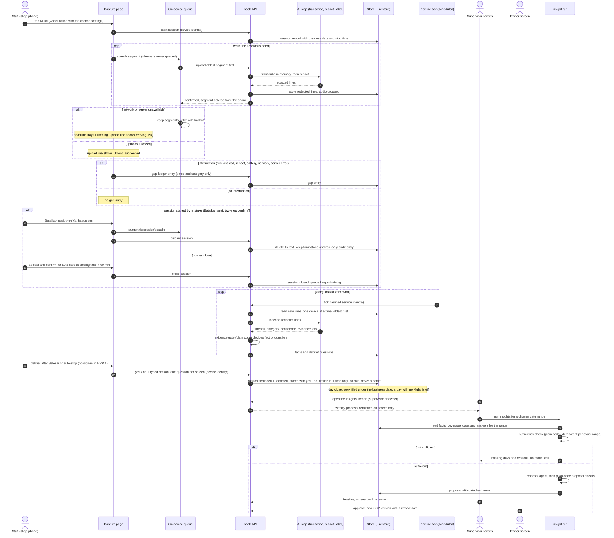

### 7.2 Manual session start and Mulai eligibility

*Per device (4 Oct, final). Mulai is the only thing that starts capture. It is offered only inside the
business day's window (01:00 to closing − 4 h, never on a closed weekday), never twice for one business
day (Selesai, auto-stop or cancel ends it, with no undo), and not before this device's previous-day
debrief has timed out, unless that day was an off-day for this device. Another device never affects it.*

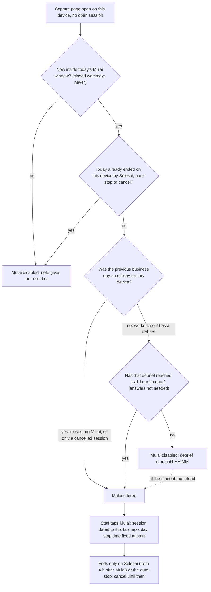

### 7.3 Capture and upload with the offline-first queue

*Green "Listening" means capture is running; it stays green for every upload result, including the
queue at its cap (§8.8 headline rule, Rangga 4 Oct). The separate upload line reports delivery
and loss. The encrypted on-device store stays off on the pilot until a written sign-off; until then the
queue is in memory only.*

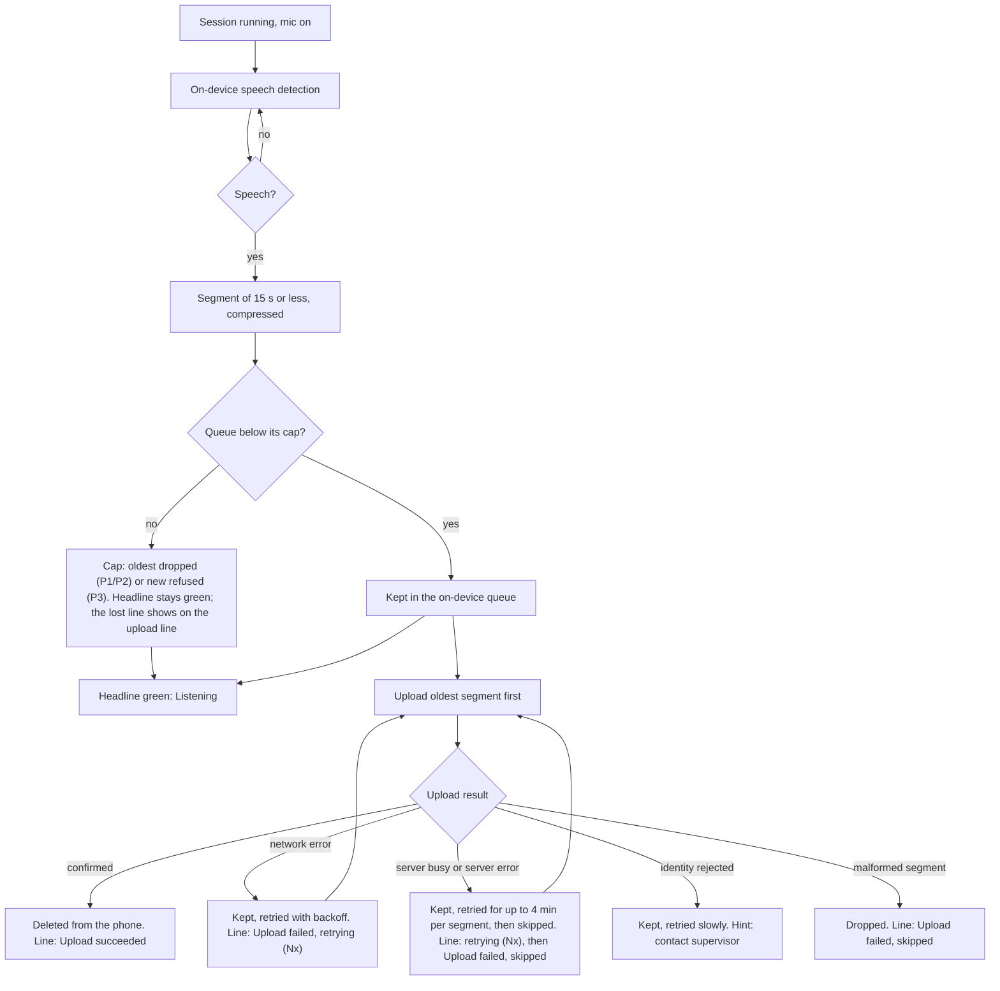

### 7.4 Gap ledger

*Every interruption becomes a ledger entry with start, end, kind and category only; capture gaps reduce
coverage, upload gaps only mean late delivery. Capture gaps open only during a session, and a cancelled
session keeps none.*

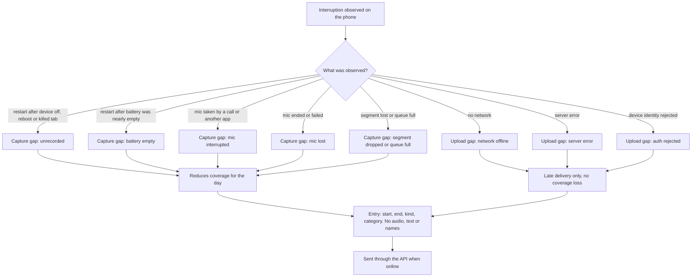

### 7.5 Cancel session

*"Batalkan sesi" discards an open session after a two-step confirm: the phone purges its audio at once,
the server deletes its text, and only a timestamp tombstone and a role-only audit count remain.*

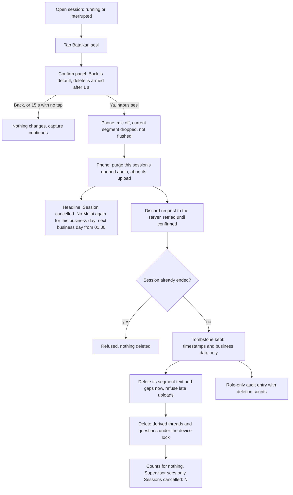

### 7.6 Auto-stop and closing checkpoints

*Opening and closing times only drive on-screen banners; the single automatic stop is closing time +
60 min. Selesai is shown from 4 h after Mulai. The debrief starts at a confirmed Selesai or the auto-stop
and lasts exactly 1 hour (fixed, §8.3 rule 5, §8.10–§8.11).*

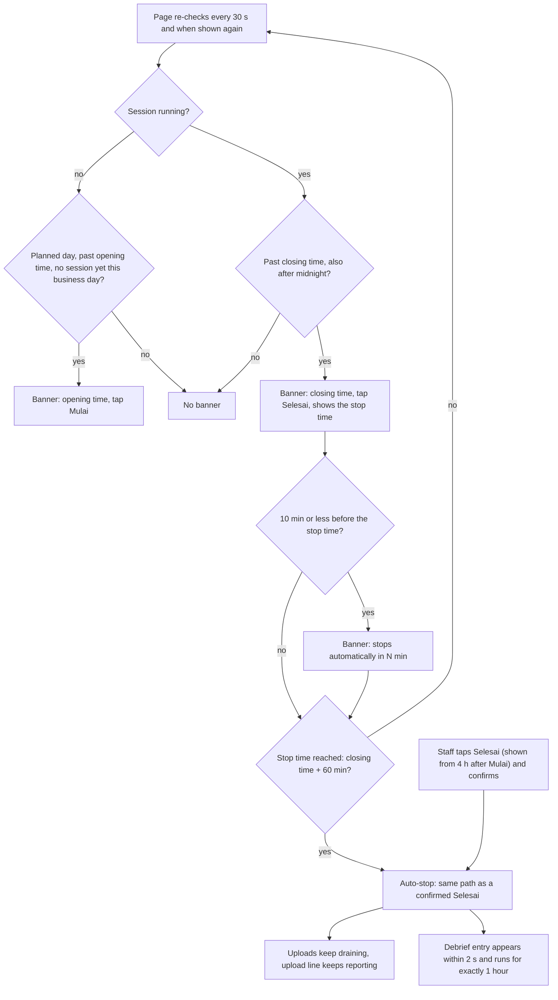

### 7.7 Business-day attribution and the day-off rule

*A session belongs to the business day whose Mulai window it started in (the calendar date of its start);
everything inside it takes that date, including its closing hour after midnight. Anything outside every
session is dated by the clock, with the day changing at 01:00. A planned day with no non-cancelled session
by the end of its Mulai window (close − 4 h) is off, with no gap alarm (§8.3 rules 2, 7; §8.4).*

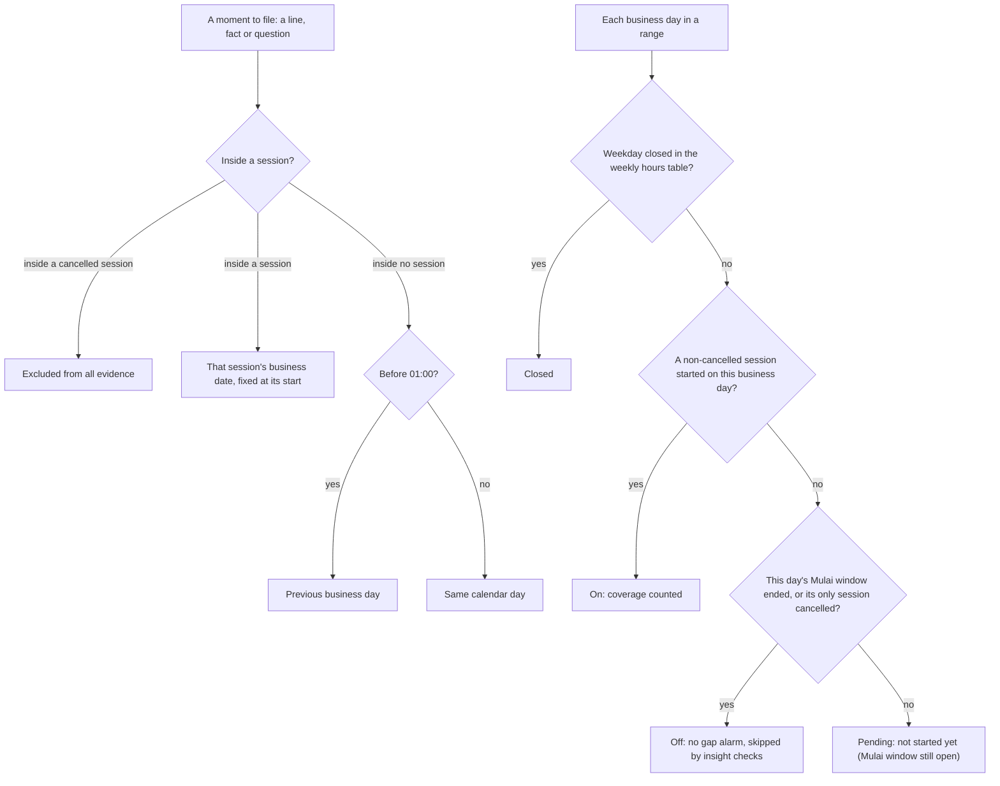

### 7.8 Debrief and staff answers

*(Updated 4 Oct, MVP 1 answer shape.) After Selesai or the auto-stop, whoever holds the paired device
answers that device's questions, one question per screen, with no sign-in (MVP 1; name + PIN sign-in is
post-MVP 1). Each answer is Yes or No plus a required reason, or Skip. Yes confirms the thread's label, No
rejects it (the thread is never used as evidence). The reason is stored without a name or role, after name
scrubbing and redaction, and is never read by the gate. Unanswered and refused questions expire as
unverified. Answering everything does not end the debrief early. Supervisors never answer here. The voice
debrief is "if time".*

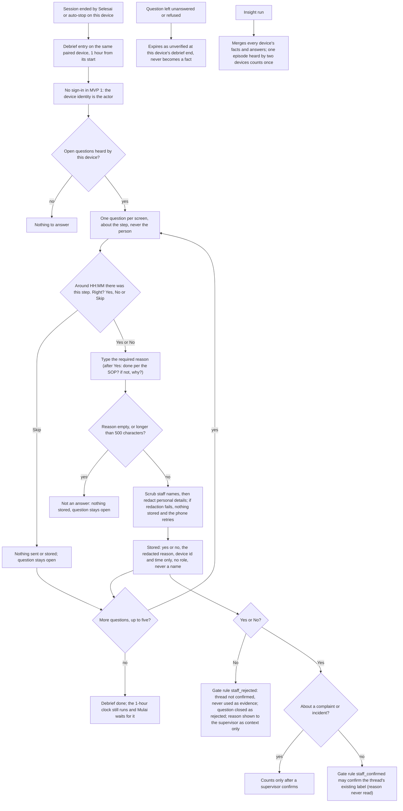

### 7.9 Insight run

*Insights run only on request by a supervisor or owner, are idempotent per exact date range
(overlapping ranges are separate runs), and call the proposal agent only when the plain-code
sufficiency check passes.*

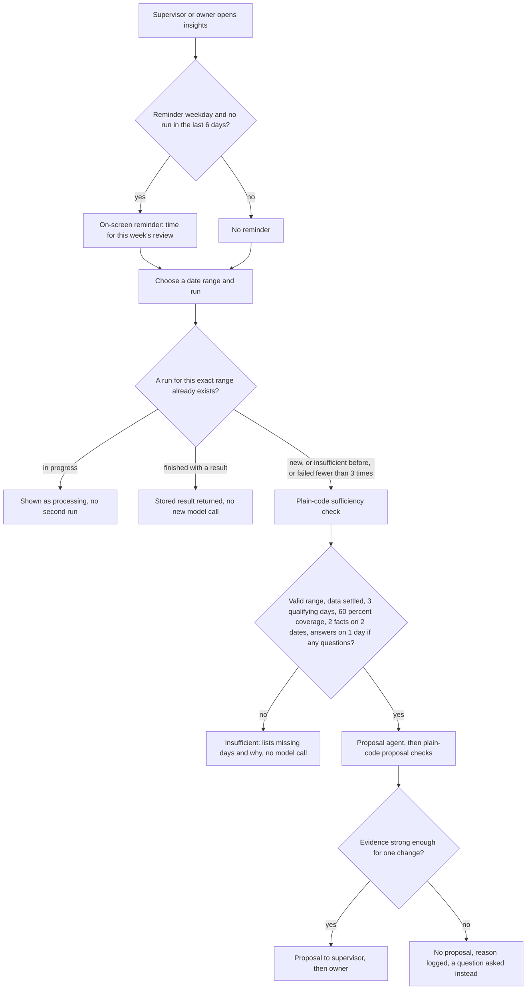

### 7.10 Consent revocation

*Revocation is a manual procedure, not an in-app action: acknowledgement and complete removal both
within 7 working days, removal by outlet and business-date range because transcripts carry no names or
speaker labels. Since 4 Oct consent is by contract plus an emailed notice, so a request arrives by email
or under the contract, and MVP 1 has no consent flag and no revoked-consent state on the phone; keeping
capture off means keeping the device token revoked.*

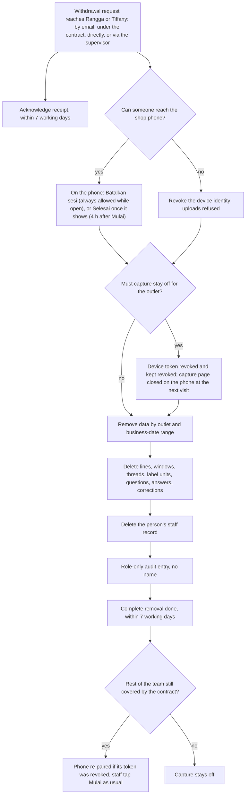

### 7.11 Pilot release and go-live gate

*Go-live is one step: an internal testing window on a test outlet in the pilot project, then the
engineer's written, dated sign-off, then a go/no-go on the first morning with a capture-only fallback.*

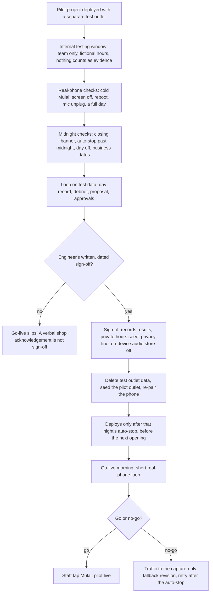

---

## 8. Session, capture and offline rules (normative; 6 Oct 2026)

**Status of this section.** Unlike §1 to §7, this section is normative. It carries the functional rules
that used to live only in a separate task plan (Rangga, 6 Oct: that plan is
removed; the revised docs are the only source). Routes, request and response bodies, Firestore
document shapes and audit entries are in `docs/specs/web-backend-rbac.md` §6.6. Phases, sizes and the
required tests are in `docs/plan.md` and `docs/backlog.md` §3a. Every string a screen shows is in
`docs/tasks/UX-03-journey-design.md` §6 (keys named below); this section never fixes wording. Function and
constant names below are the agreed names, so tests and code can be matched against them.

All times are shop-local wall clock (`outlet.timezone`). `D` is a business date. `close(D)` is D's planned
closing instant, on the next calendar day when `close <= open`. Every rule runs **per device**: each device
has its own sessions, last-ended day, debrief, debrief expiry, Mulai gate and answer cache, and there is no
outlet-level Mulai. The derived mode label (room / wearable, `docs/specs/web-backend-rbac.md` §2a) is read by
no rule here.

### 8.1 Constants

| Constant | Value | Meaning |
|---|---|---|
| `MULAI_WINDOW_OPEN_HM` | `"01:00"` | D's Mulai window opens at 01:00 on D |
| `MULAI_CUTOFF_BEFORE_CLOSE_MIN` / `_MS` | 240 min | D's Mulai window ends at close(D) − 4 h (the fixed 4 h minimum opening assumption) |
| `SELESAI_AFTER_START_MS` | 4 h | Selesai is shown from `started_at_ms` + 4 h. Defined as `MULAI_CUTOFF_BEFORE_CLOSE_MIN * 60_000` on purpose; a test asserts the two are equal, because that equality guarantees Selesai is on screen by closing |
| `MAX_NEXT_DAY_CLOSE_HM` | `"01:00"` | latest allowed close (next day) |
| `AUTO_STOP_AFTER_CLOSE_MIN` / `_MS` | 60 min | auto-stop at close + 1 h, so at the latest 02:00 |
| `AUTO_STOP_WARNING_MS` | 10 min | the "stops soon" banner shows from auto-stop − 10 min |
| `DEBRIEF_DURATION_MS` | 60 min | the debrief lasts 1 h from its start |
| `ANSWER_CACHE_MAX_AGE_MS` | 14 days | hard limit for a cached debrief answer on the phone |
| `REASON_MAX_CHARS` | 500 | debrief reason cap, in code points of the trimmed text; refused, never truncated |
| `CHECKPOINT_GRACE_MS` | 0 | banners fire exactly at opening / closing (open item Q4b, §8.19) |
| `DISCARD_ARM_MS` | 1 s | the red cancel confirm button is disabled for 1 s after the panel opens |
| `DISCARD_PANEL_TIMEOUT_MS` | 15 s | the cancel panel closes by itself after 15 s without a tap |
| `FRAME_STALL_MS` | 5 s | no VAD frame for longer than this while running = `stalled` (P2) |
| `MERGE_GAP_MS` | 60 s | cross-device merge tolerance (post-MVP 1, §8.15) |

The minute values live with the schema (so the weekly-hours validator can use them without an import
cycle); the millisecond values are derived from them.

### 8.2 Weekly hours (the day calendar)

- One table per outlet, Mon to Sun. Each weekday is `{ open: "HH:MM", close: "HH:MM" }` or `null`
  (closed that weekday). `close <= open` means the day ends on the next calendar day.
- Validation (all must hold; a failure is a data error at seed time). With `openMin = minutes(open)` and
  `closeAbs = minutes(close) + (close <= open ? 1440 : 0)`:
  1. `open !== close` (a zero-length day is an error; closed is `null`);
  2. `openMin >= 60` (opening at or after 01:00);
  3. `closeAbs <= 1500` (close at most 01:00 next day, so the auto-stop is at most 02:00 and the debrief
     ends by 03:00);
  4. `closeAbs - openMin >= 240` (open at least 4 h, so the window end is at or after opening);
  5. `closeAbs - 240 > 180` (the window ends after 03:00, the latest end of the previous day's debrief);
  6. at least one weekday is not `null` (so a next Mulai window always exists);
  7. no day's auto-stop passes the next weekday's opening: for each open weekday, `stop =
     minutes(close) + 60 + (close <= open ? 1440 : 0)`; if `stop > 1440` and the next weekday (Sun → Mon)
     is open, require `stop - 1440 <= minutes(next.open)`.
  Reference cases: 09:30-01:00 passes; 08:00-22:00 passes; close 01:30 fails (3); open 00:30 fails (2);
  20:00-23:00 fails (4); 03:00-06:30 fails (5); 20:00-02:00 followed by a 02:30 opening fails (7).
- Fallback for outlet docs seeded before weekly hours existed: every weekday = the outlet's single
  `opening_time` / `closing_time`. This is the only fallback.
- Holidays and one-off closures need no override: no Mulai by the window end makes the day off (§8.3
  rule 2). Opening on a `null` weekday means changing the weekly table in the seed, which applies to every
  such weekday. MVP 1 sets hours through the seed only (no owner screen). The pilot's real hours live only in
  the private, untracked seed config (`CLAUDE.md` §2 #8).
- A weekly-hours change never alters an already-stored session's business date or debrief end; windows
  and next-offer times are recomputed from the current table.

### 8.3 Session model rules

1. **Mulai window.** `W(D) = [01:00 on D, close(D) − 4 h]`, both ends inclusive. Because close is at most
   01:00 next day, W(D) ends at the latest at 21:00 on D, lies inside calendar day D, and two windows never
   overlap.
2. **Off-day.** No countable (non-discarded) session started in W(D) by its end → D is off, with no gap
   alarm. After the window end Mulai is not offered for D.
3. **Mulai during the previous day's closing hour.** On a past-midnight outlet part of D−1's closing hour
   `[close(D−1), close(D−1) + 1 h]` falls after 01:00 on D, inside W(D). A Mulai there is allowed whenever
   rule 6 offers it (in practice: D−1 was off, cancelled, or its debrief has ended on this device). It
   belongs to D.
4. **Selesai and the auto-stop.** `selesai_from_ms = min(started_at_ms + 4 h, close(D))`, computed once at
   Mulai, stored with the session and never recomputed (not at reload, not at Lanjutkan). Before it there
   is no Selesai button (the running view shows the "Selesai available from" note, UX-03
   `C-n-selesai-from`); from it until the session ends, Selesai is shown with its confirm. The `min` only
   guards a start outside every window (stale cached hours). `auto_stop_at_ms = close(D) + 1 h`, where D is
   the session's business date; it does not move with the start. A session that is not cancelled therefore
   runs at least 4 h unless the phone dies.
5. **Debrief.** Starts at the close trigger: `debrief_start_ms` = the session's `ended_at_ms` for
   `selesai` and `auto_stop`; for a session closed `lost`, its `auto_stop_at_ms`. No debrief follows a
   cancel. `debrief_ends_at_ms = debrief_start_ms + 60 min`, whatever happens. It can start and end on D
   itself, and it ends at the latest 03:00 on D+1. An interrupted debrief (reload, crash, app switch, phone
   off) resumes with `remaining = debrief_ends_at_ms − now`; a reload never moves its start.
6. **Mulai eligibility.** Let `E` = this device's last ended business date (`null` if none) and `E_deb` its
   `debrief_ends_at_ms` (`null` after a cancel). Mulai is offered at `now` iff all hold:
   (a) no session is open on this device and the config is loaded;
   (b) `D = businessDateOf(now)` has a window (never on a closed weekday) and `now` is in W(D), so Mulai is
       never offered before 01:00 on its business day;
   (c) `E === null` or `D > E` (one countable session per business day);
   (d) **the Mulai gate:** `E_deb === null || now >= E_deb`.
   The gate reads the clock only, never answers: a debrief nobody opened, one with no questions, and one
   answered early all release Mulai at their timeout. No code path may compare answered and total counts to
   unlock Mulai (no early release). A previous day that was off for this device (closed weekday, no Mulai,
   or only a cancelled session) has nothing to wait for. A worked day always has a debrief (every close
   trigger except a cancel starts one). If neither the phone nor the server knows that D−1 ended, (d) holds
   (fail-open). Only D−1 can block, and only between 01:00 and 03:00.
7. **Business-day attribution.** A session's `local_date` is the D whose window contains `started_at_ms`
   (the calendar date of the start). See §8.4.
8. **Cancel.** Possible only while the close has not been triggered (rule 10). A cancel ends D for Mulai:
   D's Mulai is not offered again, even while W(D) is open; a cancel in the closing hour offers no later Mulai
   for D either. With no debrief after a cancel, D+1's Mulai is offered from 01:00 on D+1, at once if that
   time has passed.
9. **Answer cache.** On the phone until uploaded, then removed; removed 14 days after the answer in any case;
   uploaded by the paired phone with its device token (§8.11).
10. **Close triggered.** Exactly one instant, the first of: (a) "Yes, end" tapped in the Selesai confirm
    (opening the panel is not a trigger; dismissing it changes nothing); (b) the auto-stop: `now >=
    auto_stop_at_ms` for a running session, or recovery closing an interrupted session at its deadline as
    `auto_stop`; (c) recovery closing a dead session as `lost`. Before the trigger the session is open and
    cancel is offered; from it, cancel is never offered, the reducer ignores `DISCARD`, and the discard route
    answers 409. Closing time itself is not a trigger.
11. **Closed weekday.** A `null` weekday has no window: Mulai is never offered on it, at any hour, with no
    override (no supervisor, owner, dev-mode or API path; the DevPanel "fake now" only moves the clock). A
    stale phone that still posts a start on a closed weekday is not refused (audited, §6.6 of the web spec);
    the day stays `closed`.
12. **No undo.** Nothing reopens an ended or cancelled business day: no supervisor, owner, dev-mode or API
    path. Both confirm panels state that it cannot be undone (UX-03 `C-c-selesai-b`, `C-c-cancel-b`).

**Definitions.** Business day D has *ended* on a device when a session with `local_date === D` is closed
with `end_reason` in `selesai | auto_stop | lost | discarded`. An open session (running or interrupted,
including its closing hour) has not ended its day. Lanjutkan resumes the same session; it is not a Mulai and
is never gated. Invariant (tested): a Mulai can never create a session whose business date has ended or lies
outside its window.

**Worked example (test outlet 09:30-01:00 every day; W = 01:00-21:00; auto-stop 02:00).** Wednesday's
session started 10:00 (Selesai shown since 14:00) and nobody taps Selesai. Thu 01:00: closing banner, no Mulai
(session open). Thu 02:00: auto-stop, debrief 02:00-03:00, Mulai disabled (`debrief_running`). Thu 03:00
(within 30 s, no reload): Mulai offered, answered or not. A Mulai at 03:05 is Thursday's (Selesai from 07:05,
auto-stop Fri 02:00). Same night with Selesai at Wed 23:30: debrief ends 00:30, Thursday's Mulai at 01:00. A
second device with no Wednesday session: its Mulai is offered at Thu 01:00 whatever the first device does.

| This device on Wednesday | Thursday's Mulai offered from |
|---|---|
| Session running at Thu 01:00, no Selesai | Thu 03:00 |
| Selesai Thu 01:10 (answered or not) | Thu 02:10 |
| Selesai Thu 01:00 exactly | Thu 02:00 |
| Selesai Wed 23:30 | Thu 01:00 |
| Early Selesai Wed 14:00 (Mulai 10:00) | Thu 01:00 (Wednesday not reopened) |
| Cancel Wed 10:05 | Thu 01:00 (Wednesday not reopened) |
| Cancel Thu 01:30 (closing hour) | Thu 01:30, at once; the new session is Thursday's |
| No Mulai by Wed 21:00 | Thu 01:00 (Wednesday off from 21:00) |
| Interrupted at Thu 00:40, not resumed | Thu 03:00 (closed `auto_stop` at 02:00, then the debrief) |
| 22:00 outlet (W = 01:00-18:00, auto-stop 23:00), Selesai 22:15 | Thu 01:00 (debrief to 23:15) |

### 8.4 Business-day attribution (pure functions)

- `businessDateOf(ms)`: the calendar date of `ms`, minus one day when `ms` is before 01:00. The 01:00
  boundary is the same for every outlet.
- A session's `local_date` is computed once by the server at start: `mulaiWindowDateOf(start) ??
  businessDateOf(start)`. Inside a window both agree; the fallback only dates a start outside every window
  (stale phone, audited). It is never recomputed.
- `attributedBusinessDate(ms, sessions, tz, device_id?)` is the **only** function any evidence date may use
  (fact counts, the day record, question and thread date ranges, the insight range, coverage). A session's
  interval is `[started_at_ms, min(ended_at_ms ?? +∞, auto_stop_at_ms))` (the auto-stop instant itself is
  outside). In order: (a) `ms` inside a discarded session → `null` (excluded from all evidence); (b) inside
  one or more other sessions → the `local_date` of the earliest-started one; (c) otherwise
  `businessDateOf(ms)`. When `device_id` is given, that device's sessions are checked first and other
  devices' only if none match.
- The two rules disagree only in a closing hour past 01:00; the session rule wins, so a session's whole
  closing hour stays with its own day. Examples (test outlet): clock rule Tue 00:59 → Mon, Tue 01:00 → Tue;
  a line at Thu 01:30 inside Wednesday's session → Wednesday; a session started Thu 01:30 (Wednesday off) →
  Thursday.
- Questions are dated by their thread's first line (`gate` kind) or by `window_start_ms`
  (`unlabelled_unit`), never by `created_at_ms`.

### 8.5 Mulai availability (the function the phone and tests share)

`mulaiAvailability({ now_ms, weekly, tz, session_open, last_ended })` returns `{ offered, reason,
business_date, next_offer_ms }`, evaluated in this order: `session_open` → reason `session_open`; `D =
businessDateOf(now)`; no window for D → `closed_day`; `E !== null && D <= E` → `day_ended`; `E_deb !== null
&& now < E_deb` → `debrief_running`; `now > W(D).end` → `window_passed`; otherwise `offered` with
`business_date = D`. `next_offer_ms`: for D' from D through D + 8 days, skip D' without a window or with
`D' <= E`; `t = max(W(D').start, E_deb ?? −∞, now)`; the first `t <= W(D').end` wins. `null` when offered or a
session is open.

- Disabled Mulai keeps its position and size; a tap on it does nothing (the reducer also ignores `MULAI`
  with `offered: false`). Each reason has a note (UX-03 §5.4: `C-m-day-ended`, `C-m-debrief`,
  `C-m-window-passed`, `C-m-closed`). Dates in notes are always written out, never "today / tomorrow".
- Becoming offered needs no reload: the 30 s timer and the `visibilitychange` check recompute availability,
  so the button enables within 30 s of `next_offer_ms`.
- The effective last-ended day is the later of the server's (`last_ended` in the capture config) and the
  phone's own record (by `business_date`, then `ended_at_ms`); both directions must work (storage cleared,
  or an end still queued offline). Each copy only moves forward (an older date never overwrites a newer one).
- A device re-paired on the **same** device doc keeps its `device_id` and so its last-ended day; pairing as a
  **new** device doc starts with none (it may start the same business day again, like a second device).
  Re-pairing for the pilot uses the same device doc.

### 8.6 Checkpoints and reminders

- The capture page re-checks every 30 s and on `visibilitychange`. It never starts or stops capture from
  the timer (a test asserts the timer never calls the capture start). The one automatic action is the
  auto-stop (§8.7), which is a stop rule, not a reminder.
- `evaluateCheckpoint`, in order: (1) a session is open with date D: `now >= close(D)` →
  `closing_session_running` (stays until Selesai or the auto-stop, across midnight), else none; (2) no open
  session, Mulai offered, and `opening(business_date) <= now <= W(business_date).end` →
  `opening_no_session` (runs to the window end, not to closing); (3) otherwise none. Never shown next to a
  disabled Mulai, never on a closed weekday. From auto-stop − 10 min the stop-soon banner replaces the closing
  banner. At most one banner at a time. Copy: UX-03 §5.2.
- Reminders are text on screen only: no sound, no vibration, no push, email or SMS (browsers block sound and
  vibration without a recent tap; a beep would also be recorded). They need the page open, in front, with the
  screen on, and can be up to 30 s late. A closing chime after Mulai is a possible later option (§8.19).
- Supervisor / owner reminder: the insights screen shows the weekly-review reminder when today's business
  date falls on `outlet.insight_reminder_weekday` (default Friday) and no insight run was started in the last
  6 local days. Computed when the screen opens; nothing is sent.

### 8.7 The capture page: views, reducer and recovery

- **Views:** `loading | error | unsupported | idle | running | interrupted | tab_busy`. There is no consent
  view (consent is by contract, §8.16).
- **Single tab.** On mount the page takes the browser lock `bee6-capture` (`ifAvailable`); if not granted it
  shows `tab_busy` and does nothing else. If the lock API is missing, it continues without the lock.
- **Config.** Fetch the capture config; on success cache it on the phone (so Mulai works when the phone starts
  offline); on failure use the cache; with no cache show `error` and never start capture blind.
- **Mulai.** Enabled only when `mulaiAvailability(now).offered` and no start is in flight (generation guard,
  so a double tap makes one session). `session_id = crypto.randomUUID()`; compute `local_date`,
  `auto_stop_at_ms` and `selesai_from_ms`; **persist the stored session before starting the mic** (a crash
  mid-start stays recoverable); then dispatch `MULAI` and send the session start (P1: direct call, 3 retries,
  failure never stops capture; P2: through the outbox). Mulai is the user gesture that also unlocks audio.
- **Selesai.** First tap opens an inline confirm (dismiss label UX-03 `C-b-belum-lanjut`); the confirm text
  states when Mulai is available again (the later of 01:00 on the next open business day and now + 1 h). On
  confirm: stop capture, dispatch `SELESAI`, clear the stored session, write the phone's last-ended record,
  send the end. The Selesai and cancel confirm panels are mutually exclusive.
- **Stop vs dispose.** Stopping capture turns off VAD and tracks and flushes the in-progress segment, but keeps
  the upload pump running and the wake lock held while the queue is non-empty; the heartbeat keeps posting
  (with `session_id: null`) until the queue is empty. Disposing (unmount, navigation) aborts uploads, releases
  the wake lock and clears timers. Upload callbacks are guarded per engine instance: after dispose, a stale
  engine's late callback changes neither status axis.
- **Lanjutkan.** In `interrupted` only, and only while `now < auto_stop_at_ms`: starts a new capture object
  with the **same** `session_id` (same operational session) and keeps the stored `selesai_from_ms` and
  deadline.
- **Reducer** (`reduceSession`, pure). Events: `CONFIG_LOADED`, `CONFIG_FAILED`, `MULAI`, `RESUME`, `SELESAI`,
  `AUTO_STOP`, `DISCARD`, `UNSUPPORTED`. `CONFIG_LOADED` with a recovered session whose deadline is in the
  future → `interrupted` (covers the closing hour after midnight); deadline passed → `idle` (the page closes it
  `lost`). `MULAI` only from `idle` and only with `offered: true`. `RESUME` only from `interrupted` before the
  deadline, regardless of availability. `SELESAI` from `running` or `interrupted`, and a no-op before
  `selesai_from_ms`. `AUTO_STOP` only from `running`. `DISCARD` only from `running` or `interrupted`, before
  and after `selesai_from_ms`. `idle` carries `ended_by: selesai | auto_stop | discarded | null` and the latest
  availability; a discard leaves "a session today" unchanged. Every other combination returns the same state
  object (tested). When Selesai and the auto-stop land in the same tick, the first event wins and the second is
  a no-op (one stop, one end request).
- **Auto-stop enforcement.** On Mulai the deadline is stored with the session. A timer to `auto_stop_at_ms`
  (re-armed in chunks of at most 24 h), the 30 s tick and the `visibilitychange` check all call the same check;
  the tick and visibility checks are the backstop for a throttled timer (worst case 30 s late while in front).
  At the deadline for a running session: the confirmed-Selesai path with no dialog (`end_reason: auto_stop`,
  `ended_at_ms` = the actual stop time); the debrief starts; uploads keep draining. An interrupted session at
  its deadline is closed `auto_stop` with `ended_at_ms = auto_stop_at_ms`. No other code path stops a session
  before its deadline except Selesai (tested: no other stop constant exists). Only the phone enforces the stop;
  the segment route refuses only discarded sessions (known gap).
- **Recovery on mount** (`planRecovery`, pure). Read the stored session S and the liveness beacon B;
  `last_alive_ms = max(B.ms if B.session_id === S.session_id, S.started_at_ms)` (a beacon older than the start,
  or from another session, is ignored). S null → nothing. `now < S.auto_stop_at_ms` → `interrupted` with
  Lanjutkan; P2 opens a recovered capture gap from `last_alive_ms`, closed at Lanjutkan or Selesai. `now >=
  S.auto_stop_at_ms` → close as `lost` with `ended_at_ms = last_alive_ms`, **no gap** (the real end is unknown),
  write the last-ended record with `debrief_ends_at_ms = auto_stop_at_ms + 60 min`, clear S, view `idle`. The
  rule is "deadline passed", not "same calendar date". Lanjutkan is never offered after the deadline.
- **Clock skew.** Eligibility, the window and the auto-stop use the phone clock. The server refuses a start
  more than 5 min in the future (capture continues locally; the dev panel shows the error). If phone and
  server disagree on `auto_stop_at_ms`, the phone's value governs when capture stops and the server's value
  governs coverage.

### 8.8 Status on the phone: two axes

**Axis 1, capture headline.** Green "Listening" means a session is open and frames are flowing. **It stays
green for every upload result and every queue state, including the queue at its cap** (Rangga, 4 Oct). Upload
results never change the headline, and the headline never describes uploads. States: `idle` (neutral),
`listening` (green), `mic_error` (red), `stalled` (red, P2), `interrupted` (amber), `ended` (neutral, after
Selesai), `ended_auto` (neutral, after the auto-stop, with the stop time), `discarded` (neutral, after a
cancel, with the server-removal line). There is no amber queue-full state and no composite
"listening, delivery delayed" headline. Copy: UX-03 §5.2, §5.3.

- `mic_error`: the mic restarts automatically (backoff from 500 ms, capped at 10 s, no attempt limit) until
  it is back or the session stops; copy may say it is retrying.
- `stalled`: the frame watchdog only observes (no frame for more than 5 s while running sets `stalled` and opens
  an `unrecorded` gap; the next frame clears both). Nothing restarts, so its copy must not say "retrying" or
  promise a restart. No "Try again" button is built for `stalled` or `mic_error` (open item, §8.19); the actions
  that exist are waiting for frames, or a reload into `interrupted` + Lanjutkan.

**Axis 2, upload line.** Shown in every view. Pure function `deriveUploadStatus(snapshot)` over
`queuedCount`, `inFlight`, `headFailCount` (consecutive failed attempts on the current head), `lastAttempt`
(`ok | network | server | auth | null`) and `lastTerminal` (`uploaded | dropped | null`). First match wins:

| # | Condition | State |
|---|---|---|
| 1 | `queuedCount > 0` and `lastAttempt` is network, server or auth | `retrying`, with N = `headFailCount` (from 1) |
| 2 | `queuedCount > 0` or `inFlight` | `uploading` |
| 3 | queue empty, `lastTerminal === "uploaded"` | `succeeded` |
| 4 | queue empty, `lastTerminal === "dropped"` | `skipped` |
| 5 | queue empty, nothing since page load | hidden |

- Hints under row 1: "server busy" only when `lastAttempt === "server"` and the browser reports online;
  "contact the supervisor" when `lastAttempt === "auth"` and `headFailCount >= 3`; none for a plain network
  failure.
- `succeeded` needs an empty queue. A 401/403 never shows `succeeded`.
- **Lost line.** Whenever a segment is dropped (a cap prune, a server-error drop after the attempt limit, or
  another 4xx drop), a separate red lost line with a ▲ marker is the first row of the upload block, above rows
  1 or 2, announced once to screen readers when it appears. It stays until the next confirmed upload (2xx);
  `succeeded` is not shown while it is up. Row 4 is the same line when nothing else is queued.
- The engine snapshot gains `upload: { inFlight, headFailCount, lastAttempt, lastTerminal }` and `queueAtCap`;
  `queueAtCap` feeds the dev panel and the gap ledger only, never the headline.

**Upload results (dispositions).**

| Result | Segment | Line | Gap (P2) |
|---|---|---|---|
| 200/201 | deleted (P3: record, and the key once the session has no records) | `uploading` while more queued, else `succeeded` | closes any open upload gap |
| network error | kept, retried forever, backoff to 30 s | `retrying` | `network_offline` open |
| 429 / 5xx | kept and retried with jittered backoff (0.5 s doubling, 30 s cap) until the head has been refused for 4 min (`HEAD_BUDGET_MS`, 18 Oct: also after Selesai, §9.3), then dropped | `retrying` + server hint; after the drop: next head, or `skipped` | `server_error` open; drop → `segment_dropped` |
| 401 / 403 (`blocked`) | kept, retried every 60 s, never counted toward the attempt limit | `retrying` + supervisor hint from N ≥ 3 | `auth_rejected` open |
| other 4xx (400, 413) | dropped | next head, or `skipped` | `segment_dropped` |
| in-memory cap prune (P1/P2) | oldest dropped | lost line | `queue_full` + `segment_dropped` |
| 200 `{ discarded: true }` (session cancelled) | dropped, never retried | unchanged | none |

After Selesai or the auto-stop the headline is `ended` / `ended_auto`, and the upload line alone reports the
drain until it succeeds.

### 8.9 Cancel ("Batalkan sesi")

- **Who and where.** Anyone at the shop, on the paired device, no PIN, no actor recorded. Shown only in
  `running` and `interrupted` (an open session); never in `idle`, `ended`, `ended_auto`, `discarded`, `error`,
  `unsupported` or `tab_busy`, so never after Selesai or the auto-stop. Placement follows UX-03 §5.6: below
  where Selesai is or will be, the same place before and after Selesai appears, never inside the area the Mulai
  button occupied, at least 48 px tall, at least 24 px from Selesai, working at 360 px.
- **Confirm.** Tapping opens an inline panel in place of the Selesai and cancel buttons (it closes the Selesai
  confirm if open, and the other way round). Capture keeps running and the headline stays green. Two stacked
  full-width buttons, "keep" first with default focus, the red "delete" below it (12 px gap), disabled for the
  first 1 s; the panel closes itself after 15 s with no tap and nothing changes. Once "delete" is tapped both
  buttons are disabled at once (generation guard): one discard only.
- **On the phone, in this order, before `DISCARD`:** (1) VAD off, tracks stopped, the in-progress segment
  **dropped, not flushed**; (2) every queued segment of this `session_id` purged (queue items carry
  `session_id`; P3 also deletes the session's records and key at once, crypto-shred); an earlier session's
  queued segments stay and keep uploading; (3) an in-flight upload of this session aborted, and a late response
  ignored; (4) the upload line's `lastAttempt`, `headFailCount` and `lastTerminal` reset, so it never shows
  "succeeded" or "skipped" because of the discarded session; (5) the stored session and the beacon cleared;
  (6) P2: every unsent outbox op and local gap of this session dropped, and no recovered gap opened for it;
  (7) a pending discard `{ session_id, started_at_ms, discarded_at_ms }` stored and sent, retried every 60 s,
  on `online` and on mount, removed on 200, 202, 409 or 422 (422 and 409 are also logged to the dev event log
  with the session id and status only); (8) the last-ended record written with `end_reason: discarded` and
  `debrief_ends_at_ms: null`; then `DISCARD`.
- **After.** Headline `discarded` with the server line (removing / will be removed when online / removed for
  10 s after the 200). Mulai disabled for that business day (§8.3 rule 8), and no opening banner. No debrief.
- **On the server.** The session becomes a timestamp-only tombstone (never deleted, so late start, end and
  segment requests cannot revive it); its stored segments and gaps are deleted at once; late segments are
  refused with 200 `{ discarded: true }`; derived threads, questions and label units are deleted under the
  device's pipeline lock (Cancel-B, below). Contracts: web spec §6.6.
- **Cancel-B cleanup** (`planDiscardCleanup`, pure; must merge before the go-live sign-off). Interval `I =
  [started_at_ms, discarded_at_ms]`, device `D`, deleted segment ids `S`. Delete: every thread of device D with
  **any** line whose segment id is in `S` or whose start is in `I` (the **whole** thread, even with earlier
  lines, because its summary may restate the discarded speech); every `gate` question of a deleted thread and
  every `unlabelled_unit` question of device D whose window overlaps `I` (with their corrections, R-07); every
  label unit of device D with a line from `S`. It runs under the device's pipeline lock: the discard route tries
  the lock once; every tick, right after taking its device lock and before reading segments, cleans each
  tombstone of that device with `cleanup_done_at_ms === null`, and skips any segment whose `session_id` is a
  tombstone (belt and braces). Until Cancel-B is merged, dev-ops removes a discarded session's threads and
  questions by hand (internal testing only). A proposal citing a discarded thread should not exist (a discard
  only hits an open session, and insight runs exclude a day in progress); if one does, its citation dangles, as
  after a revocation.
- **Counts for nothing.** Discarded sessions are filtered out before coverage; a day whose only session was
  discarded is off from the cancel on, never on, with no gap alarm; `attributedBusinessDate` returns `null`
  inside a discarded session; no gaps; heartbeats keep posting (liveness, not evidence) with `session_id: null`.
- **Supervisor visibility.** The day record shows only a per-date count of cancelled sessions, from the
  role-only audit entries: never who, never the start time, never content.
- **Races.** Auto-stop while the panel is open: the auto-stop runs, the panel closes, cancel is gone. "Delete"
  and the auto-stop in the same tick: the first reducer event wins; if the auto-stop won, the end goes out and
  no discard; if the discard won, no end goes out. An interrupted session past its deadline is closed by
  recovery first, so cancel is never offered for it. Offline: the phone purge is immediate and complete; only
  the server side waits for the pending discard.
- Cancelling only ever deletes sooner; it is not consent revocation (§8.16) and needs no request.

### 8.10 Debrief on the device

- The entry appears within 2 s of Selesai being confirmed or the auto-stop firing, and again after a reload
  inside the hour with the remaining time (from the phone's last-ended record, else the config's). No entry
  after a cancel or once the hour has passed. Whoever holds the device answers; there is no sign-in.
- At most 5 of **this device's** open questions, one per screen, role-agnostic (the SOP-implementation
  question in two parts). Screen, answer shape, reason checks and gate inputs: `docs/tasks/R-07-ux-notes.md`
  §4.2, §4b. Route contract: web spec §6.2 and §6.6.
- **Expiry (per device).** At `debrief_ends_at_ms`, every question of this device still `open` and created at or
  before that instant expires as `unverified`, picked for the debrief or not. A question created after it (a
  late tick for audio still draining) stays open until the device's next debrief end. A day without a debrief
  (off, cancelled) expires nothing. A question with no `device_id` (defensive) is expired by the outlet's first
  debrief end. Answered questions, including a NO (closed as rejected), are never set `unverified`. Mechanism and
  code change: R-07 notes §4c.
- **Answers saved first.** Each confirmed answer goes into the answer cache before the next question renders
  and before any network call, then uploads. An answer counts if `answered_at_ms <= debrief_ends_at_ms`, even if
  it reaches the server later; it then replaces `unverified`. An answer tapped after the end is refused by the
  phone (the screen is closed).
- **At the debrief end.** Confirmed answers stay in the cache until uploaded. Text typed but not confirmed is not
  saved: **there is no draft store** in MVP 1 (no `localStorage`, IndexedDB or memory copy that outlives the
  screen), so it is gone at the end and on any reload. Skipping writes nothing.
- Finishing every question does not end the debrief or release Mulai early.
- **Quoted lines (sandbox only; Rangga 18 Oct, demo-feedback-2 item 10).** On the SANDBOX (demo) the phone shows up
  to 2 already-redacted lines of the flagged thread under the question (`lines` on the question view, ≤ 160 code
  points each; the device's own thread of its own outlet; read-time staff-name scrub; fail closed: no lines when the
  staff read or the thread read fails); the pilot keeps the template-only question and its response is unchanged.
  The lines live in React state only: never in the answer cache, the answer body or any log.

### 8.11 Answer cache

- Phone key `bee6.debrief.answers`: an array of `{ question_id, debrief_business_date, answer, reason,
  answered_at_ms }`; `answer` is `yes` or `no`; `reason` is the trimmed text, 1 to 500 code points, required on
  both; a skipped question has no entry. **No name, staff id, PIN or role field** (tested by schema). The raw
  reason sits only on the phone that took it, until it is uploaded or 14 days pass; the phone never redacts, the
  server scrubs and redacts before storage.
- **Upload dispositions.** 2xx or "already answered" → remove. **400 → remove and log the question id and status
  in the dev event log only, never retried** (a malformed entry must not block the cache). 401/403, 429, 5xx and
  network failures → keep, retry every 60 s, on `online` and on mount. So "will be retried" is true for 503 and
  network failures only (UX-03 `C-d-refused` follows this).
- **Hard limit.** An entry is removed 14 days after `answered_at_ms` whether or not it was uploaded (accepted
  loss). The purge runs on mount, when the debrief opens, every 5 min while the page is open, before every
  append, and always before an upload attempt: an entry at 14 days − 1 ms is kept and sent, at exactly 14 days it
  is purged and never sent. Honest limit: the purge needs the page to run.
- **Pending count.** While the cache is non-empty the page posts heartbeats with `answers_pending` and
  `answers_pending_oldest_date` (counts and a date only), so the insight run knows a device's answers for a date
  are not all in.
- P2 may move the cache into IndexedDB; the rules stay the same.

### 8.12 On-device storage (P1 to P3)

IndexedDB database `bee6-capture`, version 1, opened in P1 with every store below (later phases need no
version bump):

| Store | Key | Value | Phase |
|---|---|---|---|
| `state` | `"current"` | `{ session_id, started_at_ms, local_date } \| null` (P1 uses `localStorage` `bee6.capture.session`) | P2 |
| `outbox` | auto | `{ op: session_start \| session_end \| gap_upsert \| session_discard, payload, created_ms }` | P2 |
| `gaps` | `gap_id` | a gap entry + `uploaded` | P2 |
| `keys` | `session_id` | non-extractable AES-GCM key | P3 |
| `audio` | `seg_id` | ids, times, sizes, IV and **ciphertext only** | P3 |
| `events` | auto | `{ ts_ms, business_date, kind, count? }` for the history screen | P1 |

`localStorage` keys: `bee6.capture.alive` (liveness beacon `{ session_id, ms, battery_pct, charging }`, written
every 5 s while running, cleared on Selesai and cancel; synchronous, survives a crash better than IndexedDB);
`bee6.capture.config` (cached capture config); `bee6.capture.pending_discards`; `bee6.capture.last_ended` (`{
business_date, end_reason, ended_at_ms, debrief_ends_at_ms }`, written in the Selesai, auto-stop, lost-recovery
and discard paths **before** the reducer event, overwritten only by a later or equal date);
`bee6.debrief.answers`. If IndexedDB is unavailable or fails to open, an in-memory implementation of the same
interface is used, `storage_degraded` is shown in the dev panel, and capture still works.

**History log ("Riwayat").** The `events` store holds no text, ids, names or device id. `kind` is `start`,
`end`, `auto_stop`, `discarded`, `debrief_window` (P1), `answers_sent` with a count (R-07), `upload_ok`,
`upload_retry` with a count, `lost` (P2); rows not yet built are not listed and the screen does not imply they
are missing. Rows sit under their business date. Rows older than 14 days are purged on every mount. Phone only:
no server read, no supervisor or owner view. With IndexedDB degraded it shows only this page load's rows.
Screen: UX-03 §5.9.

### 8.13 Offline queue (P2 outbox and gap ledger, "if time")

- **Outbox.** One sender, FIFO, one op at a time, backoff 2 s → 60 s, wakes on `online` and every 60 s.
  `session_start`, `session_end`, `session_discard` and `gap_upsert` (up to 50 consecutive gap ops batched). 2xx →
  ack. 400/422 → ack and log the op type and status in the dev event log only. 401/403 → stop and wait (the
  same blocked state as uploads). 429, 5xx, network → retry. A new `gap_upsert` for a `gap_id` with an unsent op
  replaces that op's payload (open and close of a short gap send one request).
- **Gap ledger entry.** `{ gap_id, session_id, kind, category, start_ms, end_ms | null, detected_by: live |
  recovered }`: timestamps and enums only, never audio, text, names or a free-text reason. Kinds: `capture`
  (speech not captured or lost; reduces coverage) and `upload` (captured but delivered late; never reduces
  coverage unless it turns into `queue_full`, `segment_dropped` or `expired_unsent`). Capture categories:
  `unrecorded`, `battery_empty`, `mic_interrupted`, `mic_lost`, `queue_full`, `segment_dropped`,
  `expired_unsent`, `storage_error`; upload categories: `network_offline`, `server_error`, `auth_rejected`. The
  kind is derived from the category, never sent. Categories name only what a browser can observe: an incoming
  call is `mic_interrupted`; device off, reboot and a killed tab are all `unrecorded` (README known gap).
- **Gap tracker rules.** At most one open gap per category (a repeated open is a no-op). Capture gaps open only
  while a session runs; upload gaps may open after Selesai and carry the last session id. Selesai closes every
  open capture gap. `mic_lost` opening closes `mic_interrupted` at the same instant; any specific capture gap
  (`mic_*`, `battery_empty`) opening closes an open `unrecorded` at the same instant (coverage also unions
  intervals defensively).
- **Detection.** `mic_lost`: mic error / `getUserMedia` failure / track `ended` until the mic is back.
  `mic_interrupted`: track `mute` until `unmute` (or superseded). `unrecorded` live: no frame for more than 5 s
  while running with no mic gap open, until the next frame. `unrecorded` recovered (JS freeze): a 1 s interval
  sees more than 15 s since its last tick → one closed gap over the freeze. Reload / reboot / battery: on mount
  with a stored session, a gap from the beacon time, category `battery_empty` when the beacon showed battery ≤ 5%
  and not charging, else `unrecorded`. `segment_dropped`: one closed gap over the dropped segment.
  `network_offline` / `server_error` / `auth_rejected`: open on the failed upload, closed on the next 2xx. P3:
  `queue_full` opens when a segment is refused at the cap and closes at the next accepted segment's start;
  `expired_unsent` and `storage_error` are one-shot over the segment's span.
- Until P2 lands, insight coverage counts capture-gap minutes as 0, stated in each run's result.

### 8.14 Encrypted on-device audio queue (P3, "if time"; OFF on the pilot)

- Audio waits only in the `audio` store on the capturing phone, as AES-GCM ciphertext (256-bit key, a fresh
  12-byte random IV per record, the segment id as authenticated data so a swapped record fails to decrypt).
  Plaintext exists only in memory (after encoding, and after decrypting to build the upload). One key per session,
  generated non-extractable (page script can use it but never export it). A decrypt failure deletes the record and
  records `segment_dropped`; bytes are never logged or put in an error.
- **Cap.** 4 h of speech audio or 64 MB, whichever first (open item Q3). At the cap the new segment is refused,
  older audio is never evicted; a storage-quota error counts as the cap; any other write error is a
  `storage_error`. The headline stays green; the refused segment shows on the lost line. At Mulai the page asks
  the browser to keep its storage (`navigator.storage.persist()`) and shows the result in the dev panel; if the
  browser evicts anyway, the device token goes too and the phone shows `/pair` (visible, not silent).
- **Purge.** On a confirmed upload (200/201 only) the record is deleted, and the session's key once the session
  has ended with no records left. Device retention: 24 h from enqueue; the purge runs on mount, every 5 min and
  before every enqueue, each purged unsent record records `expired_unsent`, and keys of sessions older than the
  limit are deleted. A record whose device id differs from the current pairing is purged at once
  (`segment_dropped`). Honest limit: the purge needs the page to run, so a phone left off for 3 days keeps the
  ciphertext until it is next opened ("deleted after 24 hours", never "within").
- **Uploader lifecycle.** The upload pump is created at page mount, independent of sessions, so a page opened with
  a non-empty queue and no session still uploads; a session attaches its capture half to that pump. With IndexedDB
  degraded the in-memory queue (10-minute cap) is used.
- **Why this keeps audio out of the cloud.** The only network path for audio is the existing segment upload,
  transcribed in memory and dropped. Outbox, session, gap and heartbeat payloads are strict schemas with numeric,
  enum and uuid fields only (tested: each rejects an extra field and has no free string longer than a uuid). Site
  storage is per-origin on the phone and not synced; whether Android backs it up is a real-phone check (expected
  not; even if it did, the key cannot be exported). Threat model (for the DPIA): this protects audio at rest
  against reading the browser's storage files (a copied profile, a storage dump, a lost locked phone); it does not
  protect against someone using the unlocked phone with developer tools on our origin.
- **Pilot gate (all three):** P3 built and passing the real-phone items, the new privacy line live on the pilot
  page, and Rangga's explicit, written, dated sign-off for P3. Until then the pilot build keeps
  `NEXT_PUBLIC_DEVICE_AUDIO_QUEUE=false`. The demo is not gated (fictional data).

### 8.15 Retention and insight sufficiency

**Retention.** Raw audio: never stored in the cloud (P3: on the phone at most 24 h undelivered). Segment text: 48 h
TTL (it holds pre-labelling lines, including non-work lines, so it is never kept longer; insights read threads,
not segments). Thread text (P4): `expires_at = last_line_end_ms + retention_days × 86 400 000`
(`outlet.retention_days`, default 14, 1 to 90), recomputed on every thread write so a continued thread moves its
expiry forward; a Firestore TTL policy on `threads.expires_at` deletes the whole thread doc (with Google's
documented lag, so copy says "after", never "within"); pre-P4 threads get `expires_at` from a backfill. Debrief
corrections (staff text) carry the same `expires_at` rule. Proposals cite `{ thread_id, local_date, category,
first_line_start_ms }` and never copy line text; a quote, if ever added, carries the same `expires_at`. Questions
and label units hold no text. History `events` and the answer cache: 14 days on the phone. Sessions, gaps and
insight runs: no TTL in MVP 1 (tiny, needed for coverage history; README known gap).

**Insight sufficiency** (plain code, `CLAUDE.md` §2 #10 style; version `suff-v1`, thresholds exported constants;
run trigger and idempotency: web spec §6.6).
- **Inputs, read server-side, outlet-scoped, every device:** planned intervals from the weekly hours; sessions
  dated in or overlapping `[from − 1 day, to + 1 day)` including tombstones (used only to exclude); capture-kind
  gaps; heartbeats (legacy coverage; latest per device for `oldest_queued_ms` and `answers_pending`); fact threads
  and questions dated with `attributedBusinessDate` (`null` → excluded); answered state (answered = an accepted
  YES or NO with its reason; a NO counts as answered; refused or skipped does not). The instant range `[01:00 on
  from, 03:00 on to + 1)` only selects documents; membership is by attributed date.
- **Day status** (`dayStatus`, shared with the day record): `null` weekday → `closed` (even if a stale start was
  dated to it); a non-discarded session with `local_date === d` → `on`; otherwise, if `now > W(d).end` or `d` has a
  discarded session → `off` (reason `day_off`); else `pending` (`not_started`). Closed, off and pending days are
  excluded from planned, covered and `min_days` totals and never listed as missing. Nothing is written for an off
  day. A session that ran into its closing hour after midnight marks only its own day. Honest limit: a forgotten
  Mulai looks like a day off.
- **Coverage of an `on` day `d`** with planned interval P: sessions of `d` (non-discarded, `local_date === d`);
  each interval `[started_at_ms, ended_at_ms ?? (open ? now : last heartbeat of that device in [W(d).start,
  autoStop(d)] + 60 s)]`, clamped at `auto_stop_at_ms`; `covered = |∪ sessions ∩ P| − |∪ capture gaps ∩ ∪
  sessions ∩ P|`; `coverage = covered / |P|`, minutes rounded down. If no session overlaps P but heartbeats exist
  in P, legacy coverage: each heartbeat covers the minute before it. A session of another date never adds coverage
  to `d`.
- **Per-day flags:** `in_progress` if any device has an open session of `d` (before its deadline) or `now <` any
  device's `debrief_ends_at_ms` for `d` (excluded, listed, not a failure; it is not `d === today`); `unsettled` if
  any open capture gap in P, any device's latest `oldest_queued_ms < P.end`, or answers for `d` still pending on a
  device. `qualifies = !in_progress && !unsettled && coverage >= 0.60 && fact_threads >= 1`; reasons add
  `low_coverage` and `no_facts`.
- **Rules (all must pass):** `range_valid` (`from <= to`, `to <= today`, at most 14 days, `from >= today −
  (retention_days − 1)`; a failure short-circuits the rest as not evaluated); `data_settled` (no unsettled day
  except today in progress); `min_days` (≥ 3 qualifying days); `coverage` (Σcovered / Σplanned ≥ 0.60 over
  non-closed, non-in-progress days); `evidence` (≥ 2 fact observations on ≥ 2 distinct dates); `staff_answers`
  (no questions in range, or at least one day with an answered question). Exactly-at-threshold passes. Same input
  twice gives deep-equal output. The fail message lists only days with reasons, from `days[].reasons`, no AI (copy:
  UX-03 §14).
- **Cross-device merge (post-MVP 1, `docs/plan.md` §8a; design kept here).** In MVP 1 counts are per thread, so
  two or more paired devices inflate counts; pass/fail is unchanged. Design: pure `mergeDevices`, read time only.
  Two fact threads are one observation iff they are on different devices, have the same attributed date and the
  same effective category (`confirmed_category ?? category`), and their `[first_line_start_ms, last_line_end_ms]`
  overlap or are at most 60 s apart; observations are connected components (transitive). `fact_threads` and
  `evidence` count observations. Questions whose threads match are one merged question; `unlabelled_unit` questions
  never merge; a merged question is answered when any device answered; every device's answer is kept and none
  overrides another. A NO-excluded thread never joins an observation. Pass/fail is provably unchanged (merging joins
  only same-date threads), only the counts change; one device → identity.

### 8.16 Consent, privacy and revocation

- **No consent in the app.** Consent is the bee6–shop paper contract plus an emailed consent, privacy policy and
  TnC. There is no consent flag, consent gate, consent view or revoked-consent state; the outlet's legacy
  `consent_complete` field stays optional and unread so old docs still parse, and the seed stops writing it.
- **Privacy line.** `/capture` shows the privacy notice (a notice, not consent: nothing is gated on it, nobody taps
  to accept it). The approved line stays until Rangga's formal sign-off explicitly includes the final line, and
  never before P4 (the "notes deleted after 14 days" clause is true only once P4's TTL and backfill are live); the
  demo may show the final line at any time. Wording: UX-03 §6 (Rangga's §12 final line, shortened EN accepted).
  Claim check kept with it: "never stored on our servers" (the segment route transcribes in memory and drops the
  audio; Vertex AI's default in-memory input cache of up to 24 h must be confirmed or disabled by dev-ops and covered
  in the DPIA before any longer claim); "encrypted when saved" (before P3 audio is never saved; from P3 the saved
  copy is AES-GCM); "deleted after 24 hours" ("after", because the purge needs the page to run); redacted segment
  text kept 48 h is not mentioned and so not falsely claimed. The same text goes into the emailed consent, signage
  and README. Cancel changes nothing in it (it only deletes sooner).
- **Revocation (manual, known gap).** Requests arrive by email, under the contract, in person or via the
  supervisor; Rangga or Tiffany acknowledge, and complete removal is done, both within 7 working days. The request
  details are kept in private ops notes, never in the product or repo. Steps: (1) stop capture as soon as someone
  can reach the phone: cancel (also discards the open session), or Selesai once shown; if nobody can, dev-ops
  revokes the device token (uploads refused, `blocked`; nothing more reaches the cloud, though the phone may still
  show Listening and capture into memory until someone closes the page or clears site data); to keep capture off,
  keep the token revoked; (2) remove data by outlet and business-date range (transcripts carry no names or speaker
  labels, so one person's speech cannot be picked out): `segments`, `windows`, `threads`, `label_units`,
  `questions` with their answers, `corrections`; cached answers on the phone for those dates are cleared with the
  dev-mode purge or by the 14-day limit; proposals keep dangling citations; delete the person's `staff` doc;
  audio needs no step (never stored; P3 off on the pilot); (3) one role-only audit entry per removal; (4) resume by
  re-pairing (only if the token was revoked). dev-ops runs every Firestore and IAM step, with `--project` confirmed.
  Known gaps: no in-app revoke; removal is all-or-nothing per date range; no deletion script.

### 8.17 Language behaviour

- English is the default on every new device and outlet (demo included). A top-bar `ID | EN` control on every
  screen (shop phone, supervisor, owner). Language names are never translated.
- **Storage:** one cookie `bee6_lang` (`id` or `en`), path `/`, `SameSite=Lax`, one-year max age, set by the
  browser on the tap (no API call, no server write). It is never put in an API body, Firestore, the audit log, an
  `events` row or a log line our code writes, and holds no name, device id or outlet id. Missing or unknown →
  `en`. The browser language setting is never read. Clearing site data resets to English.
- **First paint:** the server reads the cookie in the root layout (decision TL-L1, recommended option (a): the
  layout becomes async, validates the value with `z.enum(["id","en"]).catch("en")`, sets `<html lang>` and passes
  the language to a small client provider; the cost, dynamic rendering, is already the reality of an auth-gated
  app; rejected: client-only, which flashes the wrong language). A Bahasa device never flashes English.
- **A switch changes copy only:** no session state, timer, upload, fetch, focus or typed text; typed text (a
  debrief reason) is never translated. Copy lives in one typed dictionary (a missing key fails the type check), no
  i18n library; dates and times use UX-03's fixed tables, not `Intl`. Debrief category labels come from a fixed
  table keyed by the category enum; an unknown code falls back to the unlabelled template.

### 8.18 Developer-mode readouts (`NEXT_PUBLIC_DEV_CONTROLS` builds only)

- P1: session phase, short session id, "Selesai from", checkpoint value, today's Mulai window, availability
  reason and next offer, last ended business date and its debrief end, and a "fake now" offset that previews
  checkpoints, window edges and the debrief clock (never affects real builds). No override button. DEV-01's manual
  Start / Pause / Stop are removed (Mulai / Selesai are the real controls).
- R-07: answer-cache count (the same number as `answers_pending`), oldest entry age, a "purge now" button, the
  derived mode label and this device's short id.
- P2: open gaps, the last 20 gaps, outbox pending count, `storage_degraded`, a "simulate stall" button (stops
  forwarding frames for 10 s).
- P3: queue size / ms / bytes / oldest age, the `persist()` result, "purge now", and a dev-only cap override (for
  example 2 min) to reach the cap in a browser test.

### 8.19 Still open (only Rangga or Proofed can answer)

Q3 on-device audio cap (4 h / 64 MB proposed; only matters once P3 is built and signed off) · Q4b checkpoint
grace (0 built) and a later closing chime · a "Try again" control on `stalled` and `mic_error` (behaviour, not
copy; none is built) · Q29 the emailed notice (who sends it, to which addresses, by when; proposed before the
Sun 11 sign-off) · Q-U23 Bahasa debrief category labels (until both exist a question uses the unlabelled
template) · copy sign-off of UX-03 §6 (Q14 upload line, Q26 cancel copy, the Mulai notes, confirm sentences and
banners) · UX-03 C10 the one-time "upload working again" toast.

---

## 9. As built (18 Oct 2026)

What the released code (`main`, served by the demo service `web`) actually does where it differs from, or
adds to, §1 to §8. Read with the code; names below are the ones in the code.

### 9.1 Agents and their plain-code checkers

**AI suggests, plain code filters, humans decide** applies to every agent: each agent's only way to produce
an output is to submit it to a plain-code checker as tool arguments (no free-form answer is used), the checker
is pure code (hard rule #10), every agent has read-only tools and **no write tool**, and every failure falls
back to a plain-code path. All three run on Vertex AI through the Google ADK for TypeScript (`LlmAgent` +
`InMemoryRunner`), with the model location read from `config/regions.yaml`. No Critic agent exists (dropped
16 Oct): a model never judges another model; plain code does.

| | Proposal agent v4 | Debrief agent | Review agent |
|---|---|---|---|
| Job | Proposes one SOP change from a range of facts | Words the heading of a debrief question the gate already raised | Explains in plain English the before/after counts of one shipped change |
| Decides anything? | Picks among offered interventions, facts and SOP steps; the plain-code checks decide whether a proposal reaches the supervisor | No. Never picks moments, never sees the SOP | No. The verdict is `suggestVerdict` (rule `rev-v1`); the agent only explains it |
| Model | Gemini 3.5 Flash | Gemini 3.5 Flash-Lite | Gemini 3.5 Flash-Lite |
| Read tools | `list_sop_sections`, `get_sop_section`, `get_evidence` (aliases E1..En), `get_intervention`, `get_rubric` | none | `get_change`, `get_counts`, `get_evidence_sample` |
| Checker tool | `check_proposal` (`pcheck-v4`): the 8 `pgate-v1` checks, then 10 rules (`section_not_fetched`, `step_not_in_section`, `evidence_not_inspected`, `intervention_not_inspected`, `quote_alias_not_cited`, `quotes_insufficient`, `quote_not_in_evidence`, `scope_unsupported`, `change_is_noop`, `text_rule_violation`) | `check_question`: 18 rules (length 20 to 140, one yes/no question, the moment's time present, no number or content word that is not in the input, no URL, placeholder, control character, staff name, role word, instruction word, negation or compound question) | `check_review`: 20 rules, among them `verdict_mismatch` (the stated verdict must equal the rule's), `verdict_text_mismatch` (the verdict the narrative states must agree), `number_not_allowed`, `quoted_numbers_mismatch`, required and not-applicable caveats, `staff_name`, `role_or_person`, `instruction_word`, `causal_claim` |
| Other exits | `decline` | none | `decline` |
| Bounds | up to 3 checker rounds, 14 model calls, 45 s | 2 rounds, 4 model calls, 8 s (+3 s backstop) per question; at most 3 questions per unit, in parallel | 2 rounds, 10 model calls, 20 s (+5 s backstop) |
| Fallback | Any run error: one attempt of the v3 path (one structured JSON call, checked by `pgate-v1`); a proposal that fails the checks is stored as blocked, never shown as valid | The template heading (the deterministic question text) | The plain-code review card, with a notice that the explanation is missing |
| Where it runs | Every Ask (`POST /api/v1/proposals/generate`) on a service where the flag is on | Inside the pipeline tick, demo sandboxes only (`sbx-` outlet prefix); the phone shows the stored wording only while its category and start time still match the question and the flag is still on | Only inside the demo sandbox fast-forward (`project_kind: "demo"`, a `sandbox` block and the `sbx-` prefix). The daily review run (`runDueReviews`) never calls it |
| Flag (exactly `"true"`) | `PROPOSAL_AGENT_V4` | `DEBRIEF_AGENT` | `REVIEW_AGENT` |
| Stored | Proposal plus a tool-call trace (names and ok flags only); the agent's evidence quotes are checked, never stored | `agent` on the question (English wording, the category and start time it was worded for, model, version, rounds) | `agent` on the review; the stored schema refuses a doc whose `agent.suggested_verdict` differs from the stored `suggestion.verdict` |

Notes:
- **Language.** The Debrief and Review agents write English only. In a Bahasa UI the agent heading is shown in
  English and marked `lang="en"`; all other copy follows the language switch.
- **Kill switch.** Removing a flag stops that agent for every new run (for the Debrief agent the phone also
  stops showing stored wording, because the read path checks the flag too). A traffic
  rollback to an older revision is not the kill: revisions older than the agent release reject stored docs that
  carry `agent` (strict schemas).
- **Logging.** Agent runs log counts, enums, rule codes and token usage only; never a prompt, a draft, a line
  or a name.

### 9.2 The demo model (demo project `bee6-playground` only)

- **`DEMO_MODE`.** Every demo route answers 404 unless `DEMO_MODE` is exactly `"true"`; it must stay unset on
  the pilot.
- **A private sandbox per visitor.** "Try as…" creates a sandbox outlet `sbx-<12 hex>` cloned from a fictional
  template outlet (`demo-tpl-outlet`), with a judge device `jdg-<12 hex>`. A sandbox lives 2 h; the visitor
  switches role inside it with a sandbox key. Expired sandboxes are deleted lazily, at most 2 per new sandbox,
  after a 24 h grace. A standalone sweeper script exists outside the released code (not merged).
- **The 5-day journey.** Days 1 to 3 are live, scripted shop days (the judge reads fictional script cards aloud
  into the paired phone, ends the day, answers the debrief, then asks for a proposal and decides it as
  supervisor and owner). Days 4 and 5 are optional "after" days
  that unlock only once the Owner has approved a change; they feed the review.
- **Jump to closing / jump to tomorrow.** Closing unlocks once the day's required lines have been heard (5).
  "Jump to tomorrow" shifts the sandbox's own stored timestamps back 24 h (time only: no label, text, category
  or gate decision changes). Guards, in order: a shift already in flight or crashed (`busy`,
  `shift_incomplete`), `session_open`, `day_not_ended`, `preparing`, `max_days` (4 jumps), then: jumps 1 and 2
  are refused once any proposal exists (`proposal_exists`); the after-day jumps need an approved, shipped change
  and no open proposal (`approve_first`) and stop for good once a review exists (`review_exists`). Unanswered
  debrief questions need an explicit "jump anyway". After-day jumps also move the SOP version dates and review
  date with the data (§10).
- **Fast-forward.** The review can be fast-forwarded on a demo outlet; it runs the same `createReview` as the
  daily job, labelled simulated, at most 3 times per sandbox.
- **Caps** (defaults in code; some are raised by environment on `web` for judging). Per network per UTC day:
  sandboxes created (30) and role switches (60); IPs are never stored, only an HMAC keyed by `DEMO_IP_SALT`.
  Per sandbox: segment uploads 250 (a retry of the same segment is free up to 30 times), proposal Asks 8,
  fast-forwards 3, redaction calls 60, owner resets 3, jump calls 30. Across all sandboxes per UTC day: 300
  sandboxes, 3000 segments, 300 Asks and an interim ceiling of 5000 model-calling requests. Day counters reset
  at 00:00 UTC (07:00 in Jakarta). An override above a sanity bound is ignored.
- **Staging.** The service `web-develop` runs the `develop` branch in the same demo project against a named
  Firestore database `staging` (`FIRESTORE_DATABASE_ID=staging`), so tests never touch `web`'s `(default)`
  database. `FIRESTORE_DATABASE_ID` is never set on `web` or the pilot.

### 9.3 Capture and transcription resilience

- **Two ways to stop the engine.** *Finish* (Selesai, auto-stop, sign-out after closing): the open segment is
  flushed and uploads continue in the background; a segment the server refuses (429/5xx) keeps its backoff
  until its own 4-minute budget is spent or 4 minutes have passed since the stop, whichever is first, then it
  is dropped and the "not captured" notice shows. *Abort* (cancel, sign-out during a session, leaving the page):
  no new upload starts.
- **Jump to tomorrow waits for uploads.** On the demo, the jump waits up to 25 s for day-1 uploads still
  retrying, then aborts what is left, so a late note cannot land after the shift.
- **Transcription inside the request.** At most 2 attempts within a 30 s budget: each attempt is aborted
  after 10 s, and a 429/500/502/503/504 or an attempt timeout is retried once after a short jittered wait. Any
  other failure, or a second failure, answers 503 and the phone retries (§8.8). Audio stays in memory in all
  cases.
- **Shared preview capacity.** `gemini-3.5-transcribe-preview` runs on shared capacity with no raisable
  quota. When several phones start in the same second Vertex answers 429, the route answers 503, and the phone's
  retry budget usually rides it out (§10).

### 9.4 Pipeline

- **Tick.** Cloud Scheduler calls the tick every minute on `web` and every 2 minutes on `web-develop`. The
  tick works one device at a time under a per-device lease.
- **Late lines.** Lines the labeller files under a thread that is still open (for example a note delivered
  late by the retry after Selesai) are kept as continuations of that thread, not dropped (fix of 18 Oct).
- **Insight runs as built.** The "insight run" of §7.9 and §8.15 is the proposal Ask over a date range: the
  plain-code `suff-v1` range check (`range_valid`) and a plain-code evidence floor run before any model call.
  Separate insight-run records, the weekly reminder and the cross-device merge are not built (§10).

### 9.5 Flags and environment (names only; values live in Secret Manager or the service config)

| Name | Where | Effect |
|---|---|---|
| `DEMO_MODE` | demo services only | exactly `"true"` turns the demo routes on |
| `PROPOSAL_AGENT_V4` | `web`, `web-develop` | exactly `"true"`: the Proposal agent v4 (§9.1) |
| `DEBRIEF_AGENT` | `web`, `web-develop` | exactly `"true"`: the Debrief agent, sandboxes only |
| `REVIEW_AGENT` | `web`, `web-develop` | exactly `"true"`: the Review agent, sandbox fast-forward only |
| `FIRESTORE_DATABASE_ID` | `web-develop` only (`staging`) | named Firestore database; unset = `(default)` |
| `PIPELINE_TICK_AUDIENCE`, `REVIEW_RUN_AUDIENCE`, `TASKS_INVOKER_SA` | every service | the expected OIDC audience of each internal route (its own URL) and the required token issuer |
| `DEMO_IP_SALT` (secret), `DEMO_*_CAP`, `DEMO_XFF_FROM_END` | demo services | the per-IP hash salt and cap overrides (§9.2) |
| `THREAD_HANDLE_KEY` (secret) | every service | keys the opaque thread handles the supervisor's day-record actions use |
| `NEXT_PUBLIC_DEV_CONTROLS` | developer builds only | the `/capture` developer panel; never `"true"` in a real build |
| `NEXT_PUBLIC_DEVICE_AUDIO_QUEUE` | — | reserved for P3; P3 is not built and nothing reads it |

On 18 Oct the three agent flags were switched on for `web` with the release (Rangga's go); `DEMO_MODE` is on
for both demo services.

### 9.6 Deployment (as of 18 Oct)

| Piece | As built |
|---|---|
| Cloud Run `web` | demo project, `asia-southeast2`; built from `main`; the judges' service; database `(default)` |
| Cloud Run `web-develop` | demo project, `asia-southeast2`; built from `develop`; staging; database `staging` |
| Firestore | Native, `asia-southeast2`: `(default)` and `staging`, same indexes; TTL policies on `segments`, `corrections` and `demo_counters` |
| Secret Manager | runtime secrets (for example `DEMO_IP_SALT`, `THREAD_HANDLE_KEY`); no key in the repo |
| Identity | Firebase Authentication: email + password for owner and supervisor (accounts made by an admin provisioning script, no self sign-up), custom tokens for paired devices and demo role sessions; one runtime service account for every Google call (no API keys) |
| Pilot project | separate project; no service, scheduler job or build trigger deployed yet |

### 9.7 Scheduled jobs

| Job | Target | Schedule |
|---|---|---|
| `pipeline-tick` | `web` `/api/internal/pipeline/tick` | every minute |
| `review-run` | `web` `/api/internal/reviews/run` | daily 09:00 Asia/Jakarta |
| `pipeline-tick-staging` | `web-develop` tick | every 2 minutes |
| `review-run-staging` | `web-develop` review run | paused |

Both internal routes accept only an OIDC token from the configured service account with the route's own URL
as audience. The debrief and capture follow the phone (Mulai, Selesai, auto-stop), never a schedule.

### 9.8 Models, regions and privacy re-check

| Model or service | Used for | Location (from `config/regions.yaml`, probed 1 Oct) |
|---|---|---|
| `gemini-3.5-transcribe-preview` | all transcription | `global` |
| `gemini-3.5-flash-lite` | labels; Debrief and Review agents | `global` |
| `gemini-3.5-flash` | Proposal agent (v3 and v4) | `asia-southeast1` |
| Sensitive Data Protection | redaction | `asia-southeast2` |
| Live API model | voice debrief | not built; not reachable at the probe |

Cloud Run, Firestore and secrets are in `asia-southeast2`. Re-checked against the code on 18 Oct, unchanged:
audio is transcribed in memory and never written; segment text expires 48 h after it is stored; transcript
lines and debrief reasons are redacted before any write, and a redaction failure stores nothing; staff names
are scrubbed from a unit's lines before labelling and before threads copy the text; a debrief answer stores
the answering device id and timestamps only, and supervisor and owner views never return a device id; every
model location is read from `config/regions.yaml`; browsers reach Firestore only through the API.

---

## 10. Known gaps and limitations (18 Oct 2026)

The honest list. Product-facing wording for each lives in the README; this is the full technical list.

**Models and capacity**
- Transcription uses a **preview** model on **shared capacity** with no raisable quota. Several phones starting
  in the same second can get Vertex 429s; the segment route answers 503 and the phone retries. A note still
  failing after the 4-minute retry (or after the demo's 25 s jump wait) is lost and shown as not captured.
  The preview model also sometimes hangs; the per-attempt 10 s abort and one retry mitigate it.
- Transcription and Flash-Lite run on the **`global`** endpoint and Flash in **Singapore**, not Jakarta (§9.8).
- **Review agent quality.** In the 18 Oct evaluation the agreement bar (at least 90 % of runs accepted with
  the rule's verdict) was met on **5 of 8** core cases (the worked, worked-marginal and revert cases scored
  60 %, 60 % and 80 %). On core cases **12.5 %** of runs fell back to the plain card (5.6 % overall); the
  screen says when the explanation is missing. Narratives can still read awkwardly (for example "1 moments").
  Improvement is planned after submission.
- **Debrief agent** has **no circuit breaker** (risk item M4, not built): if Vertex fails repeatedly, each
  eligible question still calls the agent (bounded by the 8 s timeout and the unit's time budget) before the
  template is used, which slows the tick; the kill is removing `DEBRIEF_AGENT`. Its wording is English only.
- **Proposal agent v4** uses about 3.6 times the tokens of v3 and is slower (an Ask usually takes 10 to 30 s;
  two chained Asks take longer).
- After the agent release, rolling traffic back to an older revision breaks reads of docs that carry
  `agent`; only the flags are a safe kill (§9.1).

**Demo**
- After "Jump to tomorrow" aborts a still-retrying upload, the new day's screen can keep a stale "Not sent
  yet · retrying" row and does not show the "not captured" notice.
- Each after-day jump moves the SOP version dates and the review date back one day **by design**, so a
  screen read before the jumps can show a different review date than one read after.
- Day-3 and day-5 guide copy repeats the unlock lines, and after a review exists a lock line still says days 4
  and 5 unlock.
- A console preload hint can appear after the sign-out redirect (accepted noise).
- Expired sandboxes are only cleaned lazily; the standalone sweeper is not merged.

**Capture phases and data**
- **P2** (offline outbox and gap ledger) is not built: coverage counts capture-gap minutes as 0, and session
  start/end calls are direct with retries.
- **P3** (encrypted on-device audio queue) is not built: the queue is in memory only (about 10 minutes), so a
  reload or a long outage loses queued speech.
- **P4** (14-day thread text retention) is not built: threads have no expiry yet; debrief corrections expire
  after the outlet's `retention_days`.
- Separate insight-run records, the weekly reminder and the cross-device merge are not built; with two or
  more paired devices, counts are inflated (pass/fail unchanged).
- The per-outlet daily token ceiling (`DAILY_TOKEN_CEILING`) is not enforced; the demo has an interim daily
  count of model-calling requests only.
- Only the phone enforces the auto-stop; the server refuses only discarded sessions.
- Name-scrub limits: Indonesian clitics beyond -nya/-ku/-mu/-lah/-kah, rare invisible characters, a one-word
  staff name equal to the outlet's own word; the quoted lines on the sandbox debrief get no second redaction pass.
- Firestore TTL deletion lags, so retention copy says "after", never "within".

**Product and compliance**
- The **pilot has not gone live** (postponed 9 Oct, no new date): no real-shop results, no real gold set, no
  pilot review. The closed loop is shown on the demo only, labelled simulated.
- **DPIA** under PP 33/2026 is the next priority after submission.
- **Consent is outside the app** (contract plus emailed notice); revocation is manual within 7 working days,
  with no in-app revoke and no deletion script.
- **Bahasa copy is provisional** until Tiffany's review.
- Browser capture needs the page open, the screen on and the phone plugged in; a forgotten Mulai looks like a
  day off.
- The voice debrief (R-16) and the cheaper transcription path are not built (the latter is modelled only).
